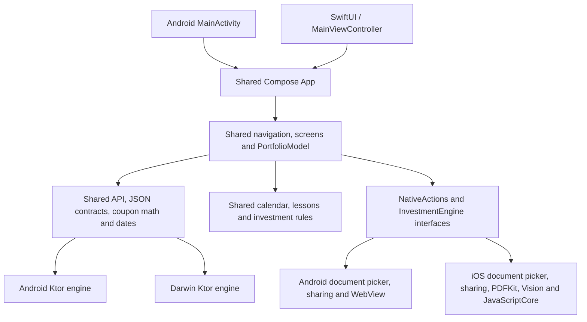

# Shared portfolio architecture

Android and iOS call the same `App()` in `app/shared/src/commonMain`. There is no second portfolio UI in either application host.

| Location | Responsibility |
| --- | --- |
| `core/src/commonMain` | Lossless API records, request/error contracts, origin validation, redirect policy, bounded streaming responses, in-memory cookie sessions, origin-bound expiry-preserving snapshots, dates and coupon calculations. No Compose or OS dependencies. |
| `core/src/androidMain`, `iosMain`, `jvmMain` | Ktor transport creation and build-specific development-HTTP policy. iOS disables native cookie persistence and HTTP caching. |
| `app/shared/src/commonMain` | All Compose screens and navigation, shared lifecycle ViewModel, validation, formatting, import review, download workflow, calendar and lessons. |
| `app/shared/src/commonMain/composeResources/files` | One calendar and education snapshot, portable numerical/purchase-parsing modules, and a generated DOM-free investment engine bundle. |
| `app/shared/src/androidMain` | Android preferences, file picker/export, URL/share intents, hardware Back, and the sandboxed browser adapter for PDF.js/Tesseract. The heavy browser/OCR assets are Android-only. |
| `app/shared/src/iosMain` | NSUserDefaults origin preference, native document import/export and share sheets, PDFKit extraction, Vision OCR, and JavaScriptCore execution of the shared investment rules. No hidden browser is needed. |
| `app/androidApp` | Manifest, launcher resources, build-variant flag and one activity calling shared `App()`. Device integration tests live here. |
| `app/iosApp` | SwiftUI lifecycle and a Compose UIViewController host. Xcode's existing embed task builds the shared framework and copies its resources. |
| `server` | Existing optional Ktor starter. Mobile clients still use the existing deployed investment API. |

## Boundaries

The shared layer decides which API calls to make, validates values, presents data, handles authentication failures, and decides when a purchase may be saved. Native adapters only provide OS capabilities. File pickers return bounded byte arrays; document export receives bytes already downloaded and checked by shared code. Native dialogs cancel without saving or importing.

The shared `PortfolioModel` extends the multiplatform lifecycle `ViewModel`. It retains no Activity, UIViewController, file picker or browser instance. Native actions and engines are owned by the UI lifecycle and cleaned up when that host is disposed. Preferences persist only connection configuration, theme, and non-secret opt-in metadata. When the user enables secure sign-in, a separate native `SecureSignIn` service persists the password and session snapshot under device authentication. iOS uses Keychain user-presence ACLs and `WhenPasscodeSetThisDeviceOnly`; Android uses an authenticated Keystore wrapping key and AES-GCM envelope encryption. Android's service references the active authentication host weakly so the shared ViewModel does not retain an Activity. Native contexts/data keys are dropped on lock. Private account records remain in memory and are reloaded from the API after unlock.

The calculation and purchase-text parsing rules have one TypeScript source snapshot in `web-logic/source`. `scripts/bundle-shared-logic.mjs` generates one portable bundle used on both platforms. Android's extraction adapter obtains text with PDF.js/Tesseract; iOS obtains text with PDFKit/Vision. Both feed the same purchase parser and shared review form. Scanned documents are marked for review. Neither adapter executes PDF JavaScript or submits extracted records automatically.

## Resources and entry points

Both application hosts reach:

`App()` → shared `PortfolioModel` → shared `InvestmentApp`.

The old Click-me/Greeting screen and placeholder arithmetic tests have been removed. Compose packages the shared `files/` tree for each platform. Android's WebView serves shared modules through its restricted virtual HTTPS resource loader; the iPhone loads the DOM-free bundle directly into JavaScriptCore. It does not ship the Android PDF.js/Tesseract runtime.

## Verification

Domain, date, API contract, cookies, origin checks and redirects are tested from `core/commonTest` so the same tests run on JVM and Native. Shared presentation rules have `app/shared/commonTest` coverage. Native PDF/engine adapters are tested separately on Android and iOS. Xcode app builds and simulator launch verify integration beyond Kotlin compilation.

For native iOS builds, open `app/iosApp/iosApp.xcodeproj` and run the existing `iosApp` scheme. Both `iosArm64` and `iosSimulatorArm64` use the same shared source. Keep personal signing settings in Xcode; this refactor preserves the existing project signing changes.

## Secure session lifecycle

Cold start with a saved record begins locked and sends no private API requests. Unlock requests native authentication, decodes only an origin-matching record, restores unexpired cookies, and checks the server session. If expired, the existing login API renews access using the protected password; this is a new server-authorized session, not a client-side extension of expiry. Invalid saved credentials are removed. Cancelling authentication keeps the app locked.

Background locking cancels pending shared actions, replaces the authenticated HTTP client, clears private state and releases native key/context material. A generation guard prevents cancelled actions from repopulating state after locking. OS-owned picker/authentication transitions are recognized so those operations can complete. Native UIKit privacy views and Android's temporary secure-window flag complement the shared inactivity cover.

Security references: [Apple Keychain accessibility and user presence](https://developer.apple.com/documentation/security/restricting-keychain-item-accessibility), [Apple local authentication](https://developer.apple.com/documentation/localauthentication/logging-a-user-into-your-app-with-face-id-or-touch-id), [Android biometric cryptographic authentication](https://developer.android.com/identity/sign-in/biometric-auth).

### Portfolio consistency and device authentication

`PortfolioModel.portfolio` is the single published `PortfolioSnapshot` of API purchases, share holdings and documents. Refresh stages all three responses before publishing; failures leave the previous snapshot intact. Overview totals and Stocks positions are derived from these same records, with a shared active-share/date filter. The overview uses invested cash (bond price plus accrued interest and fees, plus share net payable), separated by currency, rather than adding share cost to bond face value or using a separate total from another endpoint. Purchase history still shows all saved statuses. After a successful mutation, the editor closes before reloading; a reload failure explicitly confirms the save and directs the user to Sync instead of submitting again.

The native OS chooses the configured authentication method. iOS retains device-owner authentication with passcode fallback, and labels devices without usable biometrics as passcode unlock. Android 11+ accepts strong biometrics (including supported fingerprint/face/iris hardware) or device credentials with auth-per-operation Keystore crypto. Android 7–10 confirms the device screen lock through Keyguard before using a key with a five-second authorization window, allowing PIN-only phones. Legacy biometric-only records use their original key until secure sign-in is re-enabled. No credential callback alone decrypts a record: the OS must also authorize the Keystore operation.

### Monthly calendar

`CalendarEvents.kt` derives one dated timeline from bundled issuance records and the same `PortfolioSnapshot` used by the overview and Stocks. Issuance announcements, book windows and settlement dates are combined with active-purchase coupon estimates and maturity principal. `CalendarScreen.kt` renders that timeline as a Monday-first month grid, omitting trailing weeks outside the displayed month, using the same filtered events for markers and the selected-day agenda. Subscription windows connect the actual opening and closing dates with a continuous band and endpoint markers. A compact range card labels the dates and automatically focuses on the current, upcoming, or latest window in the displayed month. Invalid or reversed ranges are omitted; cross-month ranges remain visible in both months. Payment dates remain individual markers without inferred ranges. Month navigation uses calendar arithmetic with end-of-month clamping; adjacent-month dates are selectable. Source information is available through the information button rather than a large introductory panel. All date logic, filters, rendering and expansion state are shared between Android and iOS.

### Password-manager handoff

Shared sign-in invokes its transient `onAuthenticated` callback only after a successful API response. Android commits the Compose AutoFill context. iOS supplies native username/password/new-password input traits. With `GABO_PASSWORD_SHARING_ENABLED=YES`, it offers Apple Passwords saving via shared web credentials, restricted to the production HTTPS origin. The flag selects the Associated Domains entitlement file and is also embedded in Info.plist; its default `NO` permits existing Personal Team signing and prevents an unusable save offer. The native action marks the system interaction while its consent/save UI is active. The model tolerates declined/failed password-manager operations without rejecting valid login; credentials are captured at submission and input is disabled during the request. Apple Passwords entries are independent of app-vault enablement/logout. Associated Domains signing and the website's public AASA JSON establish the app/website trust relationship; see `APPLE_PASSWORDS.md` for rollout requirements.

### Photo dashboard and investment branding

`PortfolioDashboard.kt` owns the shared Portfolio landing screen, including the bundled Kigali photograph, theme-aware surfaces, Canvas diamond motif, money-only summary, horizontal insight list, and investment filters. The landing screen supplies its own photo-backed header; nested screens and other tabs retain the standard app bar. Add purchase remains the Scaffold floating action button.

The insight cards use the same `PortfolioSnapshot` and dated calendar events as the rest of the app: cash-cost allocation by currency, annual net/accrued coupons, and the next expected payment(s) on a date. Currencies are kept separate. These are record-based amounts; the AI reference’s performance chart/gain figures are not reused. Carousel arrows supplement touch scrolling and expose labeled actions to accessibility.

`InvestmentLogo.kt` maps known symbols to supplied brand resources and provides a text fallback. `PortfolioPurchaseTiles.kt` uses BNR for bonds and issuer logos for shares without tinting the marks; Stocks watchlist rows share the same component. Asset origins are recorded in `ASSETS.md`. SwiftUI observes the existing `portfolio.theme` preference so native iOS appearance follows the app’s theme selection without introducing a second setting.

### Estimated investment net worth

`PortfolioValuation.kt` is the shared valuation source for Portfolio and Stocks. It combines saved active bond principal with active share positions valued at available positive, finite RWF closing prices. Quotes never reprice non-RWF holdings; missing/invalid/future-dated quotes fall back to each position’s purchase cash cost and are counted for UI disclosure. Annual coupon income is not capitalized into net worth. Cash balances and liabilities are not tracked by this estimate. Cash allocation continues to use saved purchase cash cost, including fees.

Private-data refresh also fetches optional equity quotes when active shares exist, so Portfolio values update without opening Stocks. Optional quote failures preserve the saved snapshot and any last-known prices. The header shows quote date, cached-price status or purchase-cost fallback, with a tap-to-read valuation basis. Existing quote state is shared rather than introducing another value cache.
