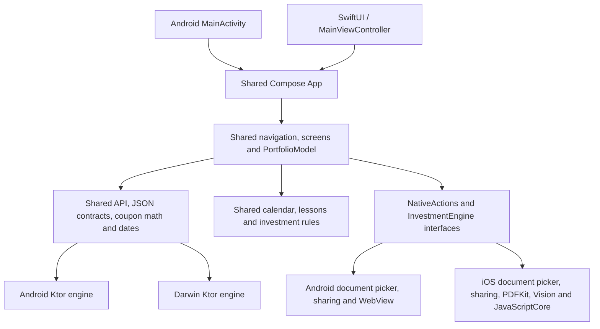

# Shared portfolio architecture

Android and iOS call the same `App()` in `app/shared/src/commonMain`. There is no second portfolio UI in either application host.

| Location | Responsibility |
| --- | --- |
| `core/src/commonMain` | Lossless API records, request/error contracts, origin validation, redirect policy, bounded streaming responses, in-memory cookie sessions, dates and coupon calculations. No Compose or OS dependencies. |
| `core/src/androidMain`, `iosMain`, `jvmMain` | Ktor transport creation and build-specific development-HTTP policy. iOS disables native cookie persistence and HTTP caching. |
| `app/shared/src/commonMain` | All Compose screens and navigation, shared lifecycle ViewModel, validation, formatting, import review, download workflow, calendar and lessons. |
| `app/shared/src/commonMain/composeResources/files` | One calendar and education snapshot, portable numerical/purchase-parsing modules, and a generated DOM-free investment engine bundle. |
| `app/shared/src/androidMain` | Android preferences, file picker/export, URL/share intents, hardware Back, and the sandboxed browser adapter for PDF.js/Tesseract. The heavy browser/OCR assets are Android-only. |
| `app/shared/src/iosMain` | NSUserDefaults origin preference, native document import/export and share sheets, PDFKit extraction, Vision OCR, and JavaScriptCore execution of the shared investment rules. No hidden browser is needed. |
| `app/androidApp` | Manifest, launcher resources, build-variant flag and one activity calling shared `App()`. Device integration tests live here. |
| `app/iosApp` | SwiftUI lifecycle and a Compose UIViewController host. Xcode's existing embed task builds the shared framework and copies its resources. |
| `server` | Existing optional Ktor starter. Mobile clients still use the existing deployed investment API. |

## Boundaries

The shared layer decides which API calls to make, validates values, presents data, handles authentication failures, and decides when a purchase may be saved. Native adapters only provide OS capabilities. File pickers return bounded byte arrays; document export receives bytes already downloaded and checked by shared code. Native dialogs cancel without saving or importing.

The shared `PortfolioModel` extends the multiplatform lifecycle `ViewModel`. It retains no Activity, UIViewController, file picker or browser instance. Native actions and engines are owned by the UI lifecycle and cleaned up when that host is disposed. Only the server origin is persisted; credentials, private records, PDFs, and cookie sessions stay in memory unless the user explicitly exports a PDF.

The calculation and purchase-text parsing rules have one TypeScript source snapshot in `web-logic/source`. `scripts/bundle-shared-logic.mjs` generates one portable bundle used on both platforms. Android's extraction adapter obtains text with PDF.js/Tesseract; iOS obtains text with PDFKit/Vision. Both feed the same purchase parser and shared review form. Scanned documents are marked for review. Neither adapter executes PDF JavaScript or submits extracted records automatically.

## Resources and entry points

Both application hosts reach:

`App()` → shared `PortfolioModel` → shared `InvestmentApp`.

The old Click-me/Greeting screen and placeholder arithmetic tests have been removed. Compose packages the shared `files/` tree for each platform. Android's WebView serves shared modules through its restricted virtual HTTPS resource loader; the iPhone loads the DOM-free bundle directly into JavaScriptCore. It does not ship the Android PDF.js/Tesseract runtime.

## Verification

Domain, date, API contract, cookies, origin checks and redirects are tested from `core/commonTest` so the same tests run on JVM and Native. Shared presentation rules have `app/shared/commonTest` coverage. Native PDF/engine adapters are tested separately on Android and iOS. Xcode app builds and simulator launch verify integration beyond Kotlin compilation.

For native iOS builds, open `app/iosApp/iosApp.xcodeproj` and run the existing `iosApp` scheme. Both `iosArm64` and `iosSimulatorArm64` use the same shared source. Keep personal signing settings in Xcode; this refactor preserves the existing project signing changes.
