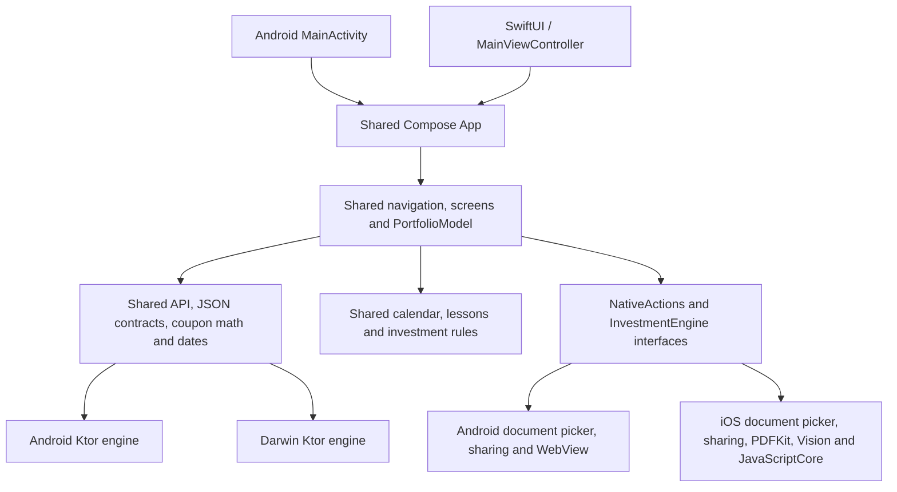

# Shared portfolio architecture

Android and iOS call the same `App()` in `app/shared/src/commonMain`. There is no second portfolio UI in either application host.

| Location | Responsibility |
| --- | --- |
| `core/src/commonMain` | Lossless API records, request/error contracts, origin validation, redirect policy, bounded streaming responses, in-memory cookie sessions, origin-bound expiry-preserving snapshots, dates and coupon calculations. No Compose or OS dependencies. |
| `core/src/androidMain`, `iosMain`, `jvmMain` | Ktor transport creation and build-specific development-HTTP policy. iOS disables native cookie persistence and HTTP caching. |
| `app/shared/src/commonMain` | All Compose screens and navigation, shared lifecycle ViewModel, validation, formatting, import review, download workflow, calendar and lessons. |
| `app/shared/src/commonMain/composeResources/files` | One calendar and education snapshot, portable numerical/purchase-parsing modules, and a generated DOM-free investment engine bundle. |
| `app/shared/src/androidMain` | Android preferences, file picker/export, URL/share intents, hardware Back, and the sandboxed browser adapter for PDF.js/Tesseract. The heavy browser/OCR assets are Android-only. |
| `app/shared/src/iosMain` | NSUserDefaults origin preference, native document import/export and share sheets, PDFKit extraction, Vision OCR, and JavaScriptCore execution of the shared investment rules. No hidden browser is needed. |
| `app/androidApp` | Manifest, launcher resources, build-variant flag and one activity calling shared `App()`. Device integration tests live here. |
| `app/iosApp` | SwiftUI lifecycle and a Compose UIViewController host. Xcode's existing embed task builds the shared framework and copies its resources. |
| `server` | Existing optional Ktor starter. Mobile clients still use the existing deployed investment API. |

## Boundaries

The shared layer decides which API calls to make, validates values, presents data, handles authentication failures, and decides when a purchase may be saved. Native adapters only provide OS capabilities. File pickers return bounded byte arrays; document export receives bytes already downloaded and checked by shared code. Native dialogs cancel without saving or importing.

The shared `PortfolioModel` extends the multiplatform lifecycle `ViewModel`. It retains no Activity, UIViewController, file picker or browser instance. Native actions and engines are owned by the UI lifecycle and cleaned up when that host is disposed. Preferences persist only connection configuration, theme, and non-secret opt-in metadata. When the user enables secure sign-in, a separate native `SecureSignIn` service persists the password and session snapshot under device authentication. iOS uses Keychain user-presence ACLs and `WhenPasscodeSetThisDeviceOnly`; Android uses an authenticated Keystore wrapping key and AES-GCM envelope encryption. Android's service references the active authentication host weakly so the shared ViewModel does not retain an Activity. Native contexts/data keys are dropped on lock. Private account records remain in memory and are reloaded from the API after unlock.

The calculation and purchase-text parsing rules have one TypeScript source snapshot in `web-logic/source`. `scripts/bundle-shared-logic.mjs` generates one portable bundle used on both platforms. Android's extraction adapter obtains text with PDF.js/Tesseract; iOS obtains text with PDFKit/Vision. Both feed the same purchase parser and shared review form. Scanned documents are marked for review. Neither adapter executes PDF JavaScript or submits extracted records automatically.

## Resources and entry points

Both application hosts reach:

`App()` → shared `PortfolioModel` → shared `InvestmentApp`.

The old Click-me/Greeting screen and placeholder arithmetic tests have been removed. Compose packages the shared `files/` tree for each platform. Android's WebView serves shared modules through its restricted virtual HTTPS resource loader; the iPhone loads the DOM-free bundle directly into JavaScriptCore. It does not ship the Android PDF.js/Tesseract runtime.

## Verification

Domain, date, API contract, cookies, origin checks and redirects are tested from `core/commonTest` so the same tests run on JVM and Native. Shared presentation rules have `app/shared/commonTest` coverage. Native PDF/engine adapters are tested separately on Android and iOS. Xcode app builds and simulator launch verify integration beyond Kotlin compilation.

For native iOS builds, open `app/iosApp/iosApp.xcodeproj` and run the existing `iosApp` scheme. Both `iosArm64` and `iosSimulatorArm64` use the same shared source. Keep personal signing settings in Xcode; this refactor preserves the existing project signing changes.

## Secure session lifecycle

Cold start with a saved record begins locked and sends no private API requests. Unlock requests native authentication, decodes only an origin-matching record, restores unexpired cookies, and checks the server session. If expired, the existing login API renews access using the protected password; this is a new server-authorized session, not a client-side extension of expiry. Invalid saved credentials are removed. Cancelling authentication keeps the app locked.

A real background transition starts a 30-second in-memory unlock grace period. Returning sooner cancels the pending lock and preserves the existing HTTP client, account state, navigation and authenticated vault context; short screenshot/system interruptions therefore do not trigger another device prompt or reload. Native/shared inactivity covers still hide the app immediately. After 30 seconds, background locking cancels pending shared actions, replaces the authenticated HTTP client, clears private state and releases native key/context material. A monotonic deadline is also checked on foreground entry, so suspended iOS timers cannot extend the grace period. Cold starts still require device authentication. A generation guard prevents cancelled actions from repopulating state after locking. OS-owned picker/authentication transitions are recognized so those operations can complete. Native UIKit privacy views and Android's temporary secure-window flag complement the shared inactivity cover.

Security references: [Apple Keychain accessibility and user presence](https://developer.apple.com/documentation/security/restricting-keychain-item-accessibility), [Apple local authentication](https://developer.apple.com/documentation/localauthentication/logging-a-user-into-your-app-with-face-id-or-touch-id), [Android biometric cryptographic authentication](https://developer.android.com/identity/sign-in/biometric-auth).

### Portfolio consistency and device authentication

`PortfolioModel.portfolio` is the single published `PortfolioSnapshot` of API purchases, share holdings and documents. Refresh stages all three responses before publishing; failures leave the previous snapshot intact. Overview totals and Stocks positions are derived from these same records, with a shared active-share/date filter. The overview uses invested cash (bond price plus accrued interest and fees, plus share net payable), separated by currency, rather than adding share cost to bond face value or using a separate total from another endpoint. Purchase history still shows all saved statuses. After a successful mutation, the editor closes before reloading; a reload failure explicitly confirms the save and directs the user to Sync instead of submitting again.

The native OS chooses the configured authentication method. iOS retains device-owner authentication with passcode fallback, and labels devices without usable biometrics as passcode unlock. Android 11+ accepts strong biometrics (including supported fingerprint/face/iris hardware) or device credentials with auth-per-operation Keystore crypto. Android 7–10 confirms the device screen lock through Keyguard before using a key with a five-second authorization window, allowing PIN-only phones. Legacy biometric-only records use their original key until secure sign-in is re-enabled. No credential callback alone decrypts a record: the OS must also authorize the Keystore operation.

### Monthly calendar

`CalendarEvents.kt` derives one dated timeline from bundled issuance records and the same `PortfolioSnapshot` used by the overview and Stocks. Issuance announcements, book windows and settlement dates are combined with active-purchase coupon estimates and maturity principal. `CalendarScreen.kt` renders that timeline as a Monday-first month grid, omitting trailing weeks outside the displayed month, using the same combined events for markers and the selected-day agenda. The filter tabs are removed; horizontal drag gestures and directional transitions navigate months, with arrows and Today retained. Subscription windows connect the actual opening and closing dates with a continuous band and endpoint markers. A compact range card labels the dates and automatically focuses on the current, upcoming, or latest window in the displayed month. Invalid or reversed ranges are omitted; cross-month ranges remain visible in both months. Payment dates remain individual markers without inferred ranges. Month navigation uses calendar arithmetic with end-of-month clamping; adjacent-month dates are selectable. Source information is available through the information button rather than a large introductory panel. All date logic, filters, rendering and expansion state are shared between Android and iOS.

### Password-manager handoff

Shared sign-in invokes its transient `onAuthenticated` callback only after a successful API response. Android commits the Compose AutoFill context. iOS supplies native username/password/new-password input traits. With `GABO_PASSWORD_SHARING_ENABLED=YES`, it offers Apple Passwords saving via shared web credentials, restricted to the production HTTPS origin. The flag selects the Associated Domains entitlement file and is also embedded in Info.plist; its default `NO` permits existing Personal Team signing and prevents an unusable save offer. The native action marks the system interaction while its consent/save UI is active. The model tolerates declined/failed password-manager operations without rejecting valid login; credentials are captured at submission and input is disabled during the request. Apple Passwords entries are independent of app-vault enablement/logout. Associated Domains signing and the website's public AASA JSON establish the app/website trust relationship; see `APPLE_PASSWORDS.md` for rollout requirements.

### Photo dashboard and investment branding

`PortfolioDashboard.kt` owns the shared Portfolio landing screen, including the bundled Kigali photograph, theme-aware surfaces, Canvas diamond motif, money-only summary, horizontal insight list, and investment filters. The landing screen supplies its own photo-backed header; nested screens and other tabs retain the standard app bar. Add purchase remains the Scaffold floating action button.

The insight cards use the same `PortfolioSnapshot` and dated calendar events as the rest of the app: cash-cost allocation by currency, annual net/accrued coupons, and the next expected payment(s) on a date. Currencies are kept separate. These are record-based amounts; the AI reference’s performance chart/gain figures are not reused. Carousel arrows supplement touch scrolling and expose labeled actions to accessibility.

`InvestmentLogo.kt` maps known symbols to supplied brand resources and provides a text fallback. `PortfolioPurchaseTiles.kt` uses BNR for bonds and issuer logos for shares without tinting the marks; Stocks watchlist rows share the same component. Asset origins are recorded in `ASSETS.md`. SwiftUI observes the existing `portfolio.theme` preference so native iOS appearance follows the app’s theme selection without introducing a second setting.

### Estimated investment net worth

`PortfolioValuation.kt` is the shared valuation source for Portfolio and Stocks. It combines saved active bond principal with active share positions valued at available positive, finite RWF closing prices. Quotes never reprice non-RWF holdings; missing/invalid/future-dated quotes fall back to each position’s purchase cash cost and are counted for UI disclosure. Annual coupon income is not capitalized into net worth. Cash balances and liabilities are not tracked by this estimate. Cash allocation continues to use saved purchase cash cost, including fees.

Private-data refresh also fetches optional equity quotes when active shares exist, so Portfolio values update without opening Stocks. Optional quote failures preserve the saved snapshot and any last-known prices. The compact header shows the currency once and amount-only figures; its information dialog exposes quote date, cached-price status, purchase-cost fallback and the valuation basis. Screen-reader amounts retain their currency. Existing quote state is shared rather than introducing another value cache.

### Recent investments and on-demand history

Portfolio previews the past 12 calendar months, capped at 12 bonds and 12 share purchases. See all opens `InvestmentHistoryScreen` with type, year and search filters. The model requests full history on demand and replaces the same canonical snapshot; subsequent visits reuse it until a sync or mutation reloads the overview. Account bond search also requests full records before displaying results.

The versioned `/api/bonds/mobile-overview` response transfers recent full records, older active bond calculation fields and grouped older share positions. Explicit recent-record IDs prevent calculation records from appearing as purchase tiles. All-time active totals, quotes and calendar schedules continue to use the complete calculation basis. A 404/405 or unrecognized overview response falls back to the original full-history API, with capability detection cached per server. The backend still reads account-scoped rows to compute this response; the saving is mobile transfer and rendering, rather than database pagination.

### Pending records and confirmation review

`PendingPurchases.kt` builds a submitted Treasury record from a published calendar bond and amount. Existing storage requires provisional price/coupon fields; the submitted status keeps these out of active financial calculations, and the pending UI deliberately hides them. `PurchaseImportScreens.kt` provides file-free pending entry and read-only PDF review. Confirmation matching uses currency, settlement, maturity, optional ISIN and actual allocation no greater than requested. An explicit target must match; ambiguous general imports require a user selection. The model updates the same purchase ID and reloads its canonical snapshot. Full history is fetched only when needed for confirmation matching.

`SettingsScreen.kt` owns System/Light/Dark appearance cards and the saved chart-style choice. Both native preferences implementations store the same logical choices. `LocalChartStyle` supplies one shared value to Stocks and projection charts without repeating controls in their screens.

### Calendar pending purchases and commission

Calendar's monthly subscription window and expanded issuance events open the shared pending purchase form with the exact issuance ID preselected. The selected calendar date is retained when returning. The amount is the applied bond principal in RWF 100,000 increments; `PendingBondCommission` adds RWF 11,000 separately as `feesPaid`. Pending detail tiles show commission and total paid but submitted records remain excluded from confirmed asset values and coupon schedules.

BNR import review waits for complete purchase history before enabling a bond save. A single pending match is selected automatically; multiple matches require explicit selection and cannot be bypassed with a separate-purchase action. Matching uses currency, settlement, maturity, optional ISIN and an allocation no greater than the applied amount. Confirmation updates the existing purchase ID with actual PDF terms and retains the recorded commission once, including when a parser returns a default fee of zero.

### Accepted documents and statement reconciliation

Add purchase accepts BNR bond results, RSE share purchase contracts, and BK Capital client statements. The first two feed the existing confirmation review; statements feed a separate reconciliation screen. `bk-statement-parser.ts` is app-specific shared parsing code bundled once for Android's WebView and iOS JavaScriptCore. It reconstructs wrapped statement references and extracts purchase journal debits and share trades. Deposits, transfers, sales and fee rows do not become investments. No statement client identifiers, contact details or raw PDF bytes are sent to the API.

`POST /api/bonds/statement-items` checks observed statement purchases against the account's canonical saved bonds/shares. Unrecorded entries persist in `bond_statement_items`, keyed by account and observed transaction identity. Repeating a statement cannot duplicate reminders. `GET` returns unresolved items only; a later confirmed purchase resolves a matching reminder without introducing a second transaction. Submitted applications do not count as completed records. Bond journal matching uses actual executed cost excluding fees and permits a posting lag of up to seven days after settlement; share matching checks broker, contract, ticker, date, quantity, price and total. Multiple possible matches remain unresolved.

Reminders are separate metadata, carry a statement debit rather than an invented principal, and never enter balances, coupons or stock positions. Portfolio shows up to three with a See all screen. Tapping one directly opens the native PDF picker, and client review verifies that the confirmation matches its observed purchase. An existing pending application is updated through the original pending matching flow. Reminder state clears on logout; invited account deletion removes reminder rows atomically with purchases/sessions. The optional GET tolerates an undeployed API so existing portfolios continue to load; statement reconciliation requires the new website deployment.

### Direct confirmation upload actions

Upload confirmation on pending tiles (Portfolio and investment history) opens the native picker directly; Details is a separate action for management/deletion. Missing-document reminders in Portfolio, the missing list and statement review also open the picker in place. No upload intermediary page or composition-triggered picker is used. `readPurchasePdf` centralizes picker cancellation, parsing, document-kind/statement checks and progress cleanup for every upload entry point. Navigation to confirmation review occurs only after successful parsing; cancellation preserves the current expanded tile, screen and filters.

### PDF import progress

All upload entry points now call `PortfolioModel.importPurchasePdf`; its shared `PdfImportProgress` state drives one modal progress dialog. The native picker reports selection before reading file bytes, allowing Opening file feedback during provider I/O. The parser reports Extracting data with actual page/OCR messages, followed by Checking details. No artificial percentage or delay is used. The busy action guard prevents duplicate requests and the modal blocks reselecting during processing. Cancel cancels the action and parser; stream loops check cancellation. Success, provider/parser failure, cancellation and session clearing reset progress, and errors then use the normal notice UI. The original screen stays behind the dialog throughout.

### Readable loading feedback and transient notices

The PDF dialog now uses one spinner with the current opening/extraction/checking status. After selection, fast results and errors retain the indicator for a minimum of one second. A brief initial render interval lets feedback paint before parsing; elapsed file-read/extraction time counts toward the minimum, so longer imports incur no additional hold. Cancellation skips the hold. This supersedes the earlier no-delay policy.

Success notices expire after three seconds and errors after five. The root app owns the timers, covering both the Portfolio hero and other screens. Notification revisions distinguish repeated identical messages, restart their timeouts, and prevent an older timer from clearing a newer notice. Manual Dismiss remains available. Platform toasts are unnecessary.

### Private PDFs for confirmed purchases

The import model retains the selected PDF only in memory, bound to its exact review. Leaving purchase review, completing the import, changing session or clearing the model releases it. Confirming an imported bond or share uploads the PDF first, then writes the purchase; pending bonds retain their original ID. The modal shows Saving PDF with chunk counts, then Confirming purchase. Upload failure never sends the purchase write. If the purchase write fails after upload, retry reuses the saved document. A failed purchase write can leave its PDF in Documents; these operations are sequential, not atomic.

The website stores private, account-scoped PDFs in the existing Postgres database. Authenticated same-origin requests send bounded 512 KiB chunks, supporting the existing 10 MiB PDF limit. Unfinished uploads stay hidden and expire after one day on the next upload for that account. SHA-256 deduplicates completed PDFs per account. Documents listing merges uploaded PDFs with the owner's bundled documents, and downloads enforce ownership. Invited-account deletion purges completed and unfinished uploads. Deploy the website schema and routes before using the updated confirmation flow; see the website DOCUMENT_UPLOADS.md checklist.

### Automatic device unlock

The shared app notifies the model on lifecycle RESUME, once the native app is active. With saved secure sign-in, the model automatically starts native device authentication while locked. An early resume queues the attempt until initial asset loading finishes. Each app visit gets one automatic prompt; cancellation or errors leave the locked screen and manual retry available. Backgrounding clears that attempt guard, but a new prompt is needed only after the unlock grace expires; authentication sheets and system file pickers do not reset it. Existing native authentication selects Face ID, Touch ID, supported Android biometrics or device credentials.

### Portfolio pull-to-refresh

Portfolio removes the hero's Sync action and uses Material's shared pull-to-refresh nested-scroll state. The full scrollable content follows the pull distance, revealing a safe-area-aware header. On release the header holds a spinner for at least one second, displays a checkmark for 650 ms on success (or an error for 900 ms), then Material settles the content back. Actual network time counts toward the minimum. Refreshes retain existing content, block duplicate actions, and use one activity indicator rather than also displaying the hero's linear loader or a success banner. Screen-reader users get a Refresh portfolio custom action. Failure retains the canonical snapshot and uses the existing error notice after the header closes. Lock/session clearing resets refresh state.

### Month agenda and contextual recording

Calendar's agenda includes all meaningful events in the displayed month, grouped chronologically under date headers, regardless of the selected day. Repeated interior Book open days remain visible in the highlighted calendar range but are omitted from the agenda. A single floating Record purchase action replaces inline pending-add buttons. It preselects the applicable, unmatured issuance in the displayed month, or offers a chooser if there are several. The existing no-file pending-entry and later confirmation flow remain unchanged.

### Monthly investment targets

Settings adds an account-and-server-scoped local monthly RWF target, default 100,000, with 100k/300k/500k shortcuts and whole-number validation. Android SharedPreferences and iOS NSUserDefaults are behind shared settings ports; target behavior, analysis and UI are shared. Changing accounts/servers clears the visible target; deleting an invited account also removes its local target preference. These preferences are device-local, not server-synced, and the current target is used for comparisons with recent months.

A goal insight in the Portfolio carousel and the three-month Settings breakdown use confirmed purchase cash cost, including fees and accrued interest, by purchase/trade date. Sold/matured records still count toward the month in which cash was invested. Pending applications are separate, and market movements/coupon income are excluded. The compact API adds twelve complete calendar months of monthlyInvestmentTotals computed before preview truncation or position aggregation. This preserves accurate progress without transferring individual lots. On an older compact server, Check progress explicitly loads full history; partial previews never masquerade as exact progress. Deploy the website mobile-overview.ts update manually using its INVESTMENT_TARGETS.md checklist.

### Hide financial numbers

The Portfolio hero and every signed-in toolbar expose an eye toggle; Settings → Privacy also includes Hide numbers. A device-local preference is loaded synchronously by the shared model and persisted through Android SharedPreferences or iOS NSUserDefaults. All screens consume the same composition-local display state. This is visual privacy, not a change to authentication or server account identity.

FinancialText replaces amounts, rates, quantities and numeric references with fixed four-dot masks before drawing or publishing semantics. Standalone amounts receive a subtle blur on the already masked string. Accessibility receives Financial numbers hidden, never the original amount. Shared formatters, records and calculations remain untouched. Purchase subtitles, facts, calendar payments, document details, share prices, projections and target analysis use the same masking path. Calendar/navigation dates remain readable. Data charts/allocation donuts are replaced with non-data placeholders, and target progress bars are omitted while hidden. Numeric form fields use secure visual transformation; target editing explicitly offers Show numbers to edit instead of exposing a selected preset. Downloaded PDFs remain original documents.

### Default capture protection

Settings → Privacy is now near the top of Settings and provides Protect screenshots & recordings, enabled by default. Its device-local screenCaptureAllowed override is separate from manual number privacy. Android briefly applies FLAG_SECURE before Compose content is created, then NativePrivacyCover clears it in the foreground so screenshots can save. With capture protection enabled, shared number privacy enforces masking on screen as well as in captures, including charts and numeric inputs; the eye toggle cannot bypass this. Disabling protection restores the independent manual Hide numbers preference. Pause/inactive windows remain protected by FLAG_SECURE for recents snapshots, and disposal does not remove that background protection.

iPhone capture protection uses an explicitly best-effort secure-text rendering workaround in `CaptureShieldViewController.swift`. The native host retains a secure UITextField and embeds the Compose child controller in its recognized text-layout canvas. It never reparents the UIWindow or window layers. Shielding covers the Compose app view; status bars, system document pickers and external apps are outside that container. Apple does not document this as a screenshot prevention API, so physical-device capture tests are required after iOS updates.

The iPhone host places an unprotected, always-redacted image underneath the secure live Compose view. `CaptureRedactionRegion` records passive masked counterparts for financial text, numeric inputs, charts and goal progress. The root records the existing scene, swaps those layers only for a synchronous Skia bitmap snapshot, restores live layers in `finally`, and publishes only the redacted image to UIKit. No unmasked bitmap is sent to the backdrop, written to disk, or exported. Shared text composition/position changes invalidate the capture image; a throttled update checks for changes and does no repeated bitmap work while idle. Main-thread rendering is configured explicitly so the live renderer cannot race a redaction swap. The monthly-target editor stays in the main protected scene because Compose platform dialogs are placed in a sibling scene.

Readiness requires both a recognized secure canvas and a prepared redacted backdrop. Failure keeps financial values masked. With readiness established, the manual Hide numbers preference alone controls the live values, including during recording/mirroring; captures see the masked backing image instead. Settings and other nonfinancial content remain visible in captures. Disabling capture protection removes the native shield and backdrop. Background privacy covers remain independent. No screenshot notification is treated as an advance warning. Android release builds use the approved on-screen masking fallback described above. Local debug builds on Android 13+ additionally try an experimental capture-only renderer. A single translucent SurfaceView above the original Compose view receives immutable live snapshots; its own SurfaceControl is marked setSkipScreenshot through the debug-only HiddenApiBypass 6.1 library. The bridge attaches only after the exclusion transaction commits. The original window draws only immutable masked snapshots made with the shared redaction registry; it never receives unmasked pixels while the experimental host is active. The original Compose view continues to own input, accessibility, navigation and the model. Both snapshots use the pinned synchronous Android Picture implementation, restoring layer alphas only after the masked bitmap exists. A successful first protected frame enables live-number visibility. Missing private API/surface/render readiness retains on-screen masking. Disabling protection clears the overlay and restores ordinary rendering. Activity destruction releases the surface bridge. No global hidden-API exemption or dependency-reporting suppression is used. The bypass library and private native host are absent from release builds. This private-API experiment has been verified only on the connected Android 15 phone and needs testing on other devices/OS releases before any distribution decision.

### Recorded share prices

Stocks combines the market-history API's `observations` (official closes) with its separate `tradeObservations` (anonymous contract execution prices). A close wins on a shared date; the latest published quote can fill a collector delay. Current valuations still use only quotes. Missing dates are never filled with invented prices. Contract history is a minimal server-side projection of saved RSE/RWF contract purchases across accounts, including bundled owner imports. No other account's holdings or PDFs are downloaded. Multiple execution prices on a date retain their range and use the distinct-price median for plotting.

The shared chart uses actual date spacing and labels selected points by source. Contract series use points with dashed guides and no filled area, explicitly indicating that daily history is incomplete. Existing clients can keep consuming only the unchanged closing-price array. Deploy the companion website change described in `gabo/SHARED_PRICE_HISTORY.md` to enable shared contracts.

Stocks uses a shared Compose `HorizontalPager` for company charts. The selected tab and watchlist highlight derive from the pager; tab/holding/watchlist taps also navigate it. History requests run only for the settled page and selected period, with an in-screen cache per symbol/period. Switching pages cancels the previous request, and each response is stored under its captured symbol/period key. Failures offer an inline retry; market refresh invalidates the cache. Chart point taps, year month labels and privacy masking remain shared on Android and iOS.

### App language

English and French share one presentation catalog (`FrenchStrings.kt`) and the `AppText` / `AppIcon` components. `AppLanguage` stores `system`, `en` or `fr` using the existing native settings adapters; the default follows the device, with English fallback. The inline France/UK flag switch in Settings → Appearance → Language switches live without recreating the navigation or session. Calendar labels, chart months, numeric output, accessibility, app-owned authentication prompts and educational blocks use the same catalog. Interpolated messages retain their dynamic values. API identifiers, JSON numbers, input dates, company names and original PDFs remain unchanged. French decimal keyboard input is normalized only when parsing numeric form fields. Add new source phrases and matching placeholders to the catalog when introducing UI text.

### Short-lived data reuse

Portfolio snapshots (including documents and reconciliation rows) and market/quote loads have a one-minute in-memory freshness window in the shared model. Repeated ordinary loads reuse recent results. Explicit pull-to-refresh, market refresh and portfolio writes bypass the cache; successful login also forces private data loading. Locking, logout, account deletion, password fallback and server changes clear freshness markers with the private records. No new private cache is persisted on disk. A short lifecycle interruption retains the existing snapshot without a session check or network reload. Shared clock injection verifies cache expiration and iOS suspension deterministically.
