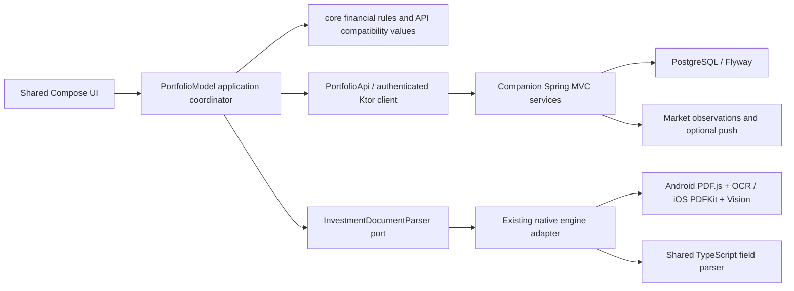

# Struct Capital codebase assessment

Audit: 30 October 2026. Start here for the current system; see [target architecture](TARGET_ARCHITECTURE.md), [decisions](DECISIONS.md), [risks and deferred work](RISKS_AND_DEFERRED.md), and [source inventory](SOURCE_INVENTORY.md).

## Scope and confidence

This was an existing-code audit, not a greenfield design. The complete source tree was inventoried, including platform hosts, build definitions, resources, scripts, tests and documentation. Financial, parser, authentication, persistence, reporting and API paths received detailed inspection. Vendor binaries/generated runtimes were reviewed as dependencies, not independently security-audited. No production data or deployment was queried.

Two repositories matter:

- This checkout, `portfolio`, baseline `5952c80`, contains Android/iPhone clients, `core`, copied TypeScript logic and a Ktor sample server. Pre-existing uncommitted document-chat improvements and business notes were preserved.
- The sibling `gabo-portfolio-api`, baseline `348ed14`, contains the actual Spring Boot application. Its tracked sources, Flyway migrations, deployment configuration and tests were inspected. Backend source was not changed. Existing pure backend tests were executed; deployment claims below are configuration/documentation evidence, not live checks.

The sibling website was not comprehensively audited. Its synchronization scripts, copied TypeScript and API proxy boundary are in scope. Old architecture and deployment notes remain useful historical evidence, but source wins when they disagree.

## Actual stack

| Area | Observed implementation |
|---|---|
| Mobile languages/build | Kotlin 2.3.21, Gradle wrapper 9.1.0, AGP 9.0.0; Android API 24 minimum / 36 compile and target |
| Shared UI | Compose Multiplatform 1.11.1, Material 3 1.11.0-alpha07, lifecycle/ViewModel 2.10.0; SwiftUI iPhone host |
| Async/data | Coroutines 1.10.2, kotlinx-datetime 0.7.1, kotlinx-serialization-json 1.9.0; mutable `JsonRecord`/`JsonList` compatibility wrappers |
| Modules | `:app:androidApp`, `:app:shared`, `:core`, `:server`; iOS Xcode host is outside the Gradle module list |
| DI | Constructor/factory injection, `expect`/`actual`, Compose locals on mobile; Spring constructor injection in the backend. No Koin/Hilt container found |
| Networking | Ktor Client 3.6.0: Android engine, Darwin on iOS, CIO on JVM; in-memory cookie jar, timeouts, bounded bodies, API-path/origin checks, redirects disabled |
| Actual backend | Separate Spring Boot 4.1.2 / Kotlin 2.3.21 / JVM 21 application, Spring MVC, Security, validation, Actuator, Flyway |
| Persistence | PostgreSQL schema with numeric columns and JSONB; JDBC `JdbcTemplate` repositories inside services. JPA dependency/plugin exists, but no entity/repository-based JPA persistence was found |
| Hosting configuration | Cloud Run container and Vercel API proxy documented; PostgreSQL on Neon / Lakebase Postgres, small Hikari pool, pooled queries and separate direct migration connection. Live settings not verified |
| Authentication | Custom opaque DB-backed sessions, not JWT/OAuth/Neon Auth. Hashed random session tokens, credential-version invalidation, 12-hour cookies, PBKDF2 new passwords, legacy scrypt compatibility, invite-based registration |
| Mobile credential storage | Optional authenticated Android Keystore/AES-GCM and iOS Keychain user-presence vault; credentials/session snapshots are separate from ordinary preferences |
| PDF extraction | Android restricted local WebView with PDF.js/Tesseract; iOS PDFKit/Vision and JavaScriptCore; shared copied TypeScript field parsers |
| PDF viewing/export | Android PdfRenderer; iOS CoreGraphics/PDFKit; Compose reader, local report generation and native sharing |
| Notifications | In-app notifications, coupon receipts/preferences and device registration; Firebase/APNs adapters are conditional on configuration |
| Tests | Kotlin common/JVM/Android tests, Android instrumentation, iOS-specific tests, Node built-in test runner; Spring JUnit/Testcontainers integration and pure parser/compatibility fixtures |

The public website constant is `https://structcapital.net`, but `PortfolioApi.DEFAULT_ORIGIN` still targets `https://bonds.orestegabo.dev` pending a verified domain cutover. These are different roles; no DNS, cookie-origin or API migration was performed.

`:server` is a small Ktor/Netty greeting sample, not the Spring financial API. Do not deploy it as a replacement backend or migrate Spring functionality into it by accident.

## Runtime and trust boundaries

A parsed PDF proposes data. It is not an authorized transaction, proof of cash arrival, a verified digital signature, or an instruction to the backend. Persisted amounts, account scope and transitions are validated server-side. Client valuations are estimates from server records and quotes, not an accounting ledger or proof of historical holdings.

## Existing functionality

The canonical five-category feature inventory is now [CURRENT_STATE.md](../CURRENT_STATE.md). It distinguishes supported working flows, partial coverage, implemented-but-unvalidated integrations, genuinely missing accounting capabilities and deliberately deferred products. The technical debt register is [TECHNICAL_DEBT.md](../TECHNICAL_DEBT.md), and sequencing belongs to [PRODUCT_ROADMAP.md](../PRODUCT_ROADMAP.md). This architecture document retains stack, trust-boundary and API evidence rather than maintaining a second feature matrix.

## Financial models and calculation ownership

- `BondTerms`, `BondTracking`, `couponSchedule`, `trackBond`: contractual dates, coupon estimates, accrual and maturity progress in `core`.
- `PortfolioSnapshot`, `SharePosition`, `CurrencyInvestment`: server record projection, active/future/status filtering, lot grouping and cost basis. Extracted from the UI module into `core` during this audit.
- `ValuedSharePosition`, `CurrencyValuation`: quote-based estimates, unpriced cost fallback and fee-aware unrealized return. Extracted into `core`.
- `MonthlyInvestmentProgress`: target progress from complete aggregates/history. Extracted into `core`.
- App-side `PendingPurchases`, `BondIssuance`, `PurchaseReviewState`, annual/report scope helpers: JSON validation/review and presentation/application policies; several pure rules remain here for incremental extraction.
- TypeScript `calculations.ts`: projection assumptions/lots/monthly cash flow. Field parsers live alongside it but now have a parser-specific Kotlin port.
- Spring `PurchaseValidation`: BigDecimal validation/derived cash cost and duplicate keys; `PortfolioService` persists account-owned purchases. `LifecycleNotifications` computes receipt amounts/schedules. `StatementService` reconciles supported statement entries. These do not currently share the KMP module.

`Double` remains in client estimates and JSON boundaries. PostgreSQL NUMERIC / backend BigDecimal do not by themselves guarantee end-to-end decimal semantics: JSON number decoding, rounding, matching tolerances and presentation must also agree. No silent monetary representation migration was performed.

## API surface inspected

Paths are under `/api/bonds`; keep compatibility with the website and existing phones.

| Family | Existing operations / ownership |
|---|---|
| `/auth` | Session/login/logout/register, owner invitations/accounts, self deletion; custom SecurityContext account |
| `/purchases` | List/get/create/update/delete; `/{id}/confirm`; all private operations derive owner from authenticated account |
| `/equities` | List and create; no general sell/corporate-action ledger API |
| `/mobile-overview` | Compact preview plus position basis and monthly totals |
| `/documents` | Account-owned chunk upload/download/list plus shared public issuance documents; hash/issuance identity constraints |
| `/statement-items` | Missing-document reminders and reconciliation; does not create unconfirmed principal |
| `/notifications` | Inbox/read/device operations; preferences, coupon receipts/manual acknowledgement, session-device and report events |
| `/rse` | Quotes/calendar/market/equity-history; scheduled collection/snapshot routes separately check bearer secrets. Public market authorization includes contract-derived history |
| `/import-diagnostics` | Bounded allowlisted technical enums rather than extracted private text |
| `/actuator/health` | Public health, details disabled |

Financial writes use Spring transactions, account-scoped SQL and PostgreSQL constraints; account advisory locks serialize supported write paths. File upload and financial save are still separate HTTP transactions, recovered through receipts/retries rather than a durable server import command.

## Assessment outcome

Keep the current product and monolithic deployment. The valuable next work is financial-contract consistency, durable provenance/audit, the statement upload mismatch and private-derived market-data controls. Those precede institutional products. See [risks](RISKS_AND_DEFERRED.md) for evidence and acceptance criteria, and [decisions](DECISIONS.md) for the limited changes actually implemented.

Verification results for this audit are recorded in the main [verification log](../VERIFICATION.md). Source inspection does not establish live configuration, regulatory approval, backup recoverability or the absence of all vulnerabilities.
