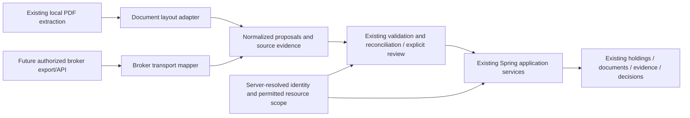

# Future broker adapters and authorized integration contracts

**Conceptual design, 30 October 2026 — not implemented APIs/types.** Read [broker opportunities and pilot gates](../BROKER_SOFTWARE.md) first. This extends the [modular-monolith target](TARGET_ARCHITECTURE.md), not a second architecture. Keep one Spring deployment/PostgreSQL database and existing mobile modules until a real operational constraint justifies otherwise.

## Existing boundaries and reuse

Today: native extraction → shared TypeScript parser → `InvestmentDocumentParser`/`EngineDocumentParser` → user review → `PortfolioApi` → Spring validation/services → account-scoped records. Statements additionally reuse `StatementService` evidence/decision handling. Reports are read projections generated by KMP, not write sources or official statements.

A later integration belongs at the input/authorization boundary of these same application services. Do not let broker SDKs/layout names dictate `BondTerms`, monetary arithmetic, portfolio UI or persistence ownership. Reuse validated commands and transaction boundaries; don't call controllers internally or copy parser expressions into Spring services. The `core` module includes networking and JSON compatibility types, so it is not yet a standalone published institutional finance library. Reconcile cross-runtime fixtures before extracting/shipping one; no source imports through developer-specific absolute paths.

The future transport branch is deliberately conceptual. There is no broker endpoint, credential flow or staff review queue behind it today.

## Keep adapter responsibilities separate

| Boundary | Conceptual input/output and constraints |
| --- | --- |
| Extraction | Bounded PDF bytes → text/layout/OCR provenance. Existing local policy, cancellation and limits remain. No broker-specific financial arithmetic or persistence. |
| Recognition | Document text/layout → supported institution, type, format and adapter version **or** unsupported/ambiguous. Exactly one supported family; institution text/logo is not cryptographic authenticity. |
| Layout mapping | Recognized input → proposed acquisitions/movements, required-field gaps, warnings and source locations. Never infer user/tenant from a name, email, CDS reference or logo. |
| Financial validation | Validate amount identities, date order, currency, rates, fees and instrument identity independently of layout. Missing required data blocks financial confirmation. Gross/net/scheduled/received distinctions remain. |
| Reconciliation | Compare only within trusted scope/account context; strong reference/instrument evidence plus amount/quantity/date checks. Ambiguous candidates need review; no amount/date-only auto match or holding per ledger row. |
| Persistence | Existing authoritative services accept validated reviewed commands. Identity/idempotency, evidence links and audit must be transactional for any future durable import command. |
| Broker transport | Future authorized read-only interface/export → normalized proposals. Handles the broker's pagination/cursors/revisions and credentials, never investment calculations or implicit cross-client authority. |

## Proposed contracts, not new wire DTOs

Use the following as a contract-review checklist when implementing a validated pilot. Preserve existing endpoints and JSON fields during additive evolution; schema version and parser version serve different purposes.

| Conceptual contract | Required semantics |
| --- | --- |
| `ParserDescriptor` | Existing `{institution, documentType, format, version}` identity; documented supported inputs/limitations and regression fixtures. Adapter version is Struct's mapping version, not an official broker file version. |
| `SourceEvidence` | Owned original document ID/digest, origin (`user-upload` or a later verified connector), extraction method/version, parser descriptor, occurrence/page reference and source-issued time when present. Broker authenticity/transport verification is a separate status. Digests support identity, not authenticity. |
| `ImportProposal` | Contract schema version, descriptor/evidence, proposed records, explicit missing fields and warnings. Keep acquisition, fee, cash receipt, coupon, dividend and other movement types distinct. No proposal grants access or posts records. |
| Financial values | Future wire decimals as bounded decimal strings plus currency/unit; quantities separate from money; percentage/fraction semantics explicit. ISO calendar dates for trade/settlement/coupon dates and offset instants for receipt/audit events. Preserve official dates and configurable tax/rounding policy. Current numeric DTOs remain until versioned migration. |
| `AuthorizedImportCommand` | Server-resolved actor and target context, permitted source, account-scoped idempotency key, reviewed proposal/revision and action. Client fields may identify a requested resource but cannot establish authority. Expected-record versions prevent stale corrections. |
| `ImportOutcome` | Stable import/result IDs, created/reused financial/source IDs, rejected/review-required outcomes, decision/evidence references and revision. Do not equate upload completion, successful parsing, saved acquisition and reconciled movement. |
| Future `BrokerReadAdapter` | Describe proven capabilities; read only the authorized external accounts/time period/data kinds; return bounded pages with stable external IDs/revisions and opaque cursor/completeness. No order/payment/settlement operation. No assumption an actual broker supports OAuth, webhooks, exports or stable IDs. |

Unknown required fields mean rejection/review, never zero. Unknown optional fields remain absent. A source correction creates a new version/evidence occurrence and reconciliation review rather than rewriting the historical source. Reject unsupported schema versions and partially understood event types; an unsupported sale cannot become a purchase. No parser may directly invoke `saveBond`/`saveShare`.

For an eventual broker-account mapping use a server-verified tuple of institution, connection, external account and event ID/revision. A CDS/account reference is not a transaction reference. Event identity and byte identity are different: identical file reuse does not prove identical economic events, and a new file can describe an already-recorded event. Do not broaden the current BK duplicate/matching rules to another broker without account-collision fixtures and an intentional migration.

## Broker-specific parser onboarding

Reuse [DOCUMENT_PARSING.md → Adding another broker or format](../DOCUMENT_PARSING.md#adding-another-broker-or-format) as the implementation checklist. No registry is needed for the current four layouts. Add an independent layout module behind the existing entry point when an authorized sample set actually exists; introduce a registry only if real adapter count makes explicit dispatch hard to maintain.

Additional contract gates for any institution:

1. Obtain sample-use permission and document issuer/layout/date, supported instruments/currencies and legitimate variations. Keep originals private; sanitize visible text, hidden layers, metadata, account IDs and signatures before fixtures. Preserve synthetic cases reproducing layout behavior.
2. Specify institution + type + layout recognition independently from dispatch order. Test overlap with BNR/BK, sales, repeated/concatenated documents and near matches; ambiguous multi-adapter recognition blocks confirmation. Current family guards are not universal recognition rules for unseen brokers.
3. Supply a mapping table for every supported field: exact source label/location, normalized name, unit/scale, date semantics, required/optional rule, validation and missing-field outcome. Reuse common numeric/date validation; keep institution layout quirks inside the adapter.
4. Distinguish acquisition totals and separate charges; don't add fees twice. Map statement movements to evidence-only categories unless a separately designed domain supports posting them. Never manufacture coupon/dividend receipt evidence or missing instrument terms.
5. Verify both native text extraction and OCR/platform paths; add reader/PDF fixtures, ESM-versus-portable output parity, financial validation tests, adversarial/ambiguous cases and held-out samples. Document coverage limits rather than promising all PDFs from an institution.
6. Version descriptor/fixtures deliberately. A layout change is not an unexplained regex expansion. Never relabel old imports with the newest parser or silently reprocess originals into financial changes. Preserve old metadata/behavior where needed for retry and historical explanation.
7. Test review, current APIs, source ownership, multiple external accounts, idempotency/recovery and no writes on rejection. The existing Spring `StatementService` hardcodes BK/RWF: another parser alone **does not** enable another broker's reconciliation. Extend that validation/matching boundary with tested institution-specific identity mapping when required, keeping core matching safety rules common.
8. Regenerate the shipped ESM/portable bundle through the existing script and coordinate client/backend compatibility. The generator currently depends on a configured TypeScript toolchain (default sibling website path); record the toolchain used. A standalone parser package/toolchain can be separated only for an actual second consumer, not as speculative infrastructure.

## Future authorization and isolation requirements

These controls are prerequisites for an institutional implementation, not existing features:

- Keep personal `owner_id` semantics. Do not set it to a broker name or let a caller select another investor. If institutions become real, add a separately modeled organization/membership/resource scope through additive migrations with deterministic personal-workspace backfill and old-client compatibility.
- Distinguish platform operator, institutional administrator, assigned reviewer, read-only reporter, investor and machine principal. Role examples need customer validation. Broker admin is never `ROLE_OWNER`; it must not enumerate existing personal accounts or grant itself investor delegations.
- Authorization is the intersection of authenticated principal, active membership/delegation, allowed operation, specific resources/data classes and purpose/time bounds. Machine credentials and human investor sessions are separate. Avoid shared staff passwords, client-side tenant filters or a global broker API key with all-customer access.
- Enforce scope on every query, object/download/proof/report lookup, mutation, source/decision history, export, cache, scheduled job and notification. Scope uniqueness/idempotency by organization **and appropriate client/external account**; tenant-only scoping is insufficient when references repeat per client. Public issuance/reference data stays distinct from private evidence.
- Future shared tables require tenant-safe relationships/constraints as well as application checks. Current V8 owner columns and foreign keys were designed for individual-account enforcement; adding an organization column does not automatically make joins or constraints safe. Design migration/backfill/isolation tests before enabling any new scope.
- Log actor and effective customer/resource scope for authorized financial/audit actions, including support access, without credentials/PDF text. Require an explicit time-limited support-access process; no default support browsing or cross-customer aggregation/training.
- Test all denial paths using two institutions, two clients in one institution, personal-only users, revoked grants and service principals. Include guessed IDs, exports, documents, jobs, shared caches, stale decisions and credential rotation. Default deny unknown scopes; test revocation between fetch and commit.

Do not implement membership tables, policy engines, SSO, tenant databases or enterprise queues now. A real pilot must choose its isolation/deployment model before using real customer records; an isolated synthetic evaluation can proceed without those capabilities.

## Customer-authorized synchronization principles

No live synchronization is implemented. A future investor connection must:

1. Identify the institution and verified external account through a supported authorization process. Use broker-authorized delegated credentials if available; otherwise consider explicit exports. Do not scrape portals, collect broker passwords/OTPs, reuse Struct cookies or assume an API exists.
2. Present separate explicit choices for direction, accounts, date range, data kinds, refresh frequency, purpose, recipients, original PDFs and write permissions. Start read-only with minimum scope. An invitation, sponsor code, logo or terms acceptance is not a synchronization grant.
3. Record consent/grant version, actor, scope, expiry, authority and revocation state, while separately validating applicable legal basis/contract. Broker institutional processing and investor-to-broker sharing may have different legal roles; neither implies the other.
4. Bind encrypted/secret-managed tokens to the specific connection and scope; minimize retention, permit revocation/rotation and never expose them to unrelated staff/logs. Technology/authentication method is selected only after a real supported interface is verified.
5. Validate grant before retrieval **and before applying** a batch. Revoke future fetches and pending work promptly; invalidate affected caches and machine access. A revoked client cannot be reattached automatically by email or an import row.
6. Preserve cursor/completeness/watermark and source revisions per connection. Overlapping pages/retries return the same outcomes. Do not assume cursor advance proves every event committed; persist outcome and checkpoint atomically where the source semantics permit. Explain partial failures, stale data and last success to the user.
7. Route conflicting source updates through reconciliation. Never let a broker update silently erase an investor note/correction, interpret a missing page as deleted holdings, or turn scheduled income into received cash. No deletion is inferred from an incomplete source snapshot.
8. Offer disconnect, scope review and portable export. Explain treatment of already imported records, prior recipients, retention and backups. Disconnect does not recall exported files or nullify lawful retention; it must stop future access through the connection.

## Decision gates and non-goals

Require demonstrated task value, authorized corpus, financial correctness, source authenticity expectations, contract/legal scope, access model, acceptable operating cost, export/offboarding and a named owner for exception handling before implementation. Use the [pilot plan](../BROKER_SOFTWARE.md#pilot-validation-before-building-or-accessing-customer-records); no interface examples imply an agreement.

No broker CRM/customer master, trading terminal, full tenancy, live brokerage API, securities execution, custody, settlement or licensing functionality is implemented or required by this design. Institution-scale statement generation, official valuation, cash accounting, maker/checker approvals, SLA queues, signed snapshots and regulatory retention remain separate validated product decisions. Existing individual screens/APIs are preserved.
