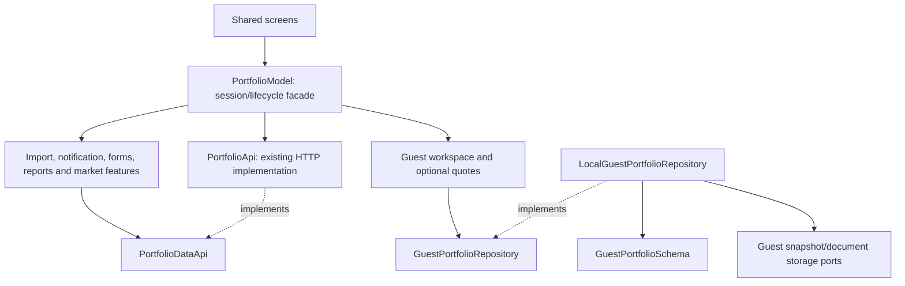

# Repository responsibility and SOLID review

Reviewed 15 November 2026 against baseline `80a6c88`.

## Scope and method

The inventory scanned the tracked Kotlin, Swift, TypeScript, JavaScript, Python, shell and Gradle sources in this repository. The baseline contained 343 first-party source/build files, 141 test files, 24 packaged runtime files and three generated/data files. After this work there are 363 first-party files and 145 test files; packaged runtimes and data are unchanged.

Manual responsibility review focused on the largest production owners, public interfaces, I/O boundaries, lifecycle/cancellation behavior and duplicated protocols. File length identified candidates; it was not treated as a class-size limit. The external Spring backend is not in this repository and was not changed or deployed. The small optional `server` starter was reviewed and retained.

## Changes

| Area | Separation | Preserved contract |
|---|---|---|
| Account data | `AccountSnapshotReader` handles overview compatibility, fallback reads and projection assembly | Fresh pending records/documents, optional-resource failures, unauthorized errors and origin compatibility reset |
| Market data | `PortfolioMarketData` owns market/quote caching; `EquityPriceHistory` owns per-screen history requests | Existing cache/retry behavior, cancellation and loading revisions |
| Local guest workspace | `PortfolioGuestWorkspace` owns serialized operations; `PortfolioGuestQuotes` owns optional read-only quote loading | Foreground/mode/revision gates, local-only writes and byte/error handling |
| Guest persistence | Storage contracts remain in `GuestPortfolioRepository`; `LocalGuestPortfolioRepository` owns durable operations; `GuestPortfolioSchema` validates records | Schema versions, IDs, normalization, encryption/storage ports, durable deletion and backup formats |
| Application forms | `PortfolioApplicationForms` owns public form loading/upload and subscription bids | Authorization, subscription-window validation, action guard, confirmation and refresh order |
| Documents | `PortfolioDocumentViewer` owns preview state, PDF validation and request invalidation | Guest byte disposal, stale-preview protection, cancellation and annual-report previews |
| Privacy | `PortfolioPrivacy` owns device preferences and number visibility | Independent screenshot/number settings and platform masking rules |
| Administration | `PortfolioAdministration` handles accounts, publisher permissions and invitations; `SettingsRecordsSheet` renders the sheet | Requests only execute through the supplied authenticated action boundary; failed writes do not report success |
| PDF upload | `PdfChunkUploader` implements the shared transport protocol | 512 KiB chunks, stable upload IDs, payload bytes, metadata, early document reuse and cancellation/error propagation |
| Presentation | Calendar, credentials, settings and reusable form/display components have focused files | Existing component bodies, financial masking, keyboard/autofill, labels and callbacks |
| App composition | `InvestmentPlatformEffects` separates OS bridge effects from route ordering; `PresentationComponents` removes generic UI primitives from the root | Existing effect keys, engine disposal, notification/widget routing and notice lifetimes |
| Screen data access | Navigation, security activity and stock history call feature methods instead of issuing HTTP requests | Existing paths, response interpretation and errors |

The extracted features do not own an independent authenticated session, start a new application scope, change a storage schema or introduce a new runtime dependency.

## Dependency direction

`PortfolioDataApi` exposes only JSON requests and binary downloads. Feature services depend on this capability or smaller function/host ports. `PortfolioApi` implements the capability with its existing HTTP policy. Session snapshot restoration, cookie clearing and client shutdown remain with the session owner rather than feature services.

## SOLID decisions

- **Single responsibility:** separate storage validation, transport chunking, feature state, OS effects, commands and presentation. An import workflow or screen can still contain several related steps.
- **Open/closed:** transport, storage, parser and native capability boundaries permit alternate implementations without rewriting the feature workflow. No speculative plugin framework or inheritance tree was added.
- **Liskov substitution:** existing method/response/error contracts and native adapter contracts remain intact. The HTTP implementation inherits the same default request arguments through the data interface. Existing tests were retained; expectations were not rewritten to accommodate the refactor.
- **Interface segregation:** data features cannot restore sessions or close clients. Import/form/notification hosts expose the capabilities their workflows use; small read/send callbacks support independent components.
- **Dependency inversion:** feature code depends on data/storage/host interfaces and injected functions/scopes. HTTP engines and native services remain implementations wired by composition owners.

These are design decisions supported by review and tests, not an automatic certification that every line of a mature application satisfies an abstract rule.

## Size and retained owners

Counts are source-file lines, not a claim that every file is one class.

| Source owner | Before | After |
|---|---:|---:|
| `PortfolioModel` | 1,302 | 1,118 |
| `InvestmentApp` | 657 | 500 |
| Guest repository contracts/implementation | 469 combined | 41 contracts, 328 implementation, 116 schema |
| `CalendarScreen` | 469 | 221 |
| `SettingsScreen` | 448 | 301 |
| `SignInScreen` | 437 | 360 |
| Stock screen (`LibraryScreens` → `StocksScreen`) | 296 | 213 |
| `InvestmentChart` | 483 | 302 |
| `PortfolioImports` | 431 | 408 |

The obsolete commented-out chart and subscription-card implementations were removed. Added files contain the extracted responsibilities; the work is not intended to minimize total line count.

`PortfolioModel` remains the larger compatibility facade and session/lifecycle coordinator. Its screen-facing API, action guard, private synchronization and security-sensitive ordering stay centralized. `InvestmentApp` retains route priority so the authentication and privacy gates remain explicit. Dashboard/document screens, the PDF renderer and the share-extension controller were retained where their behavior is already cohesive. The 2,004-line French translation map is data, and large test fixtures describe scenarios rather than production ownership. Generated runtimes, TypeScript financial rules and native cryptographic/signing code were not rewritten for size.

## Verification

- 409 shared host tests passed, including 11 new tests for chunk transport, account snapshot fallback/authentication, history caching/cancellation and administration action boundaries.
- 89 core JVM tests passed.
- Android debug and instrument APK builds passed.
- Seven isolated emulator UI checks passed: onboarding, guest experience, two calendar/form scenarios, target editing, sign-in/autofill and PDF import/retry/library routing.
- Physical-iPhone target build passed, including the widget/share extensions. This is build verification, not a new hardware authentication test.
- Design-color source audit and its three tests passed; `git diff --check` passed.

An emulator startup warning and a competing Android CLI automation connection were cleared before the successful UI run. No application behavior assertion was weakened to pass those checks.

## Subsequent integration review — 15 November 2026

The baseline inventory and exclusions above are historical. The [combined review](../quality/KMP_PENDING_CHANGES_REVIEW.md) reviews and verifies the previously pending extractions with the design/accessibility and financial-presentation work. It records actual intermediate/final gates, small review corrections, current source ownership and remaining manual validation. Existing schema/API/calculation contracts remain unchanged.
