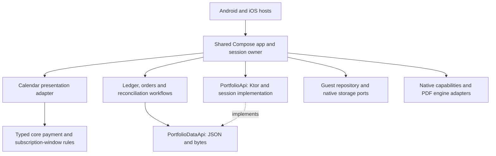

# INZIRA architectural boundaries

Reviewed 15 November 2026 against commit `414b0ab` and the current working tree. This document records the implemented architecture, a focused separation-of-concerns change and its remaining limits. The Spring backend and website are outside this change.

## Existing architecture

INZIRA uses shared Compose Multiplatform presentation, a session/lifecycle ViewModel, feature state/workflow collaborators, common financial functions and native service adapters. Wiring is manual through constructors, callback providers and `expect`/`actual` factories. It is not a strict Clean Architecture implementation, and this change does not introduce a new architecture framework.

The module graph remains **Android host → shared app → core**. The iOS host embeds the shared framework. `:server` is an optional separate Ktor starter, not a mobile dependency. `core` targets Android, JVM, iOS device and iOS simulator; `app:shared` targets Android and the two iOS targets. Both have `commonMain`/`commonTest` and platform implementations; shared also has native integration and Android host tests. No Gradle dependency or build-plugin configuration is changed here.

| Concern | Actual owner and observations |
|---|---|
| Presentation | Shared Compose screens, localized labels, icons, filters, navigation and `PortfolioModel`/feature observable state. Compose state is the existing state-management convention. The model owns session/action/guest gates. Some manual purchase validation and request assembly still remain in `PurchaseForms`; this step does not rewrite those forms. |
| Domain | `core/commonMain` contains typed `BondTerms`, schedule/tracking, decimal monetary boundaries, valuation, grouping, ledger and projection rules. New typed payment/window rules live here. These rules have no Compose/Android dependency. `core` as a module also contains transport; it should not be described as an entirely pure domain module. |
| Data access | `PortfolioApi` implements the shared HTTP/session policy. Feature workflows invoke a data-only port. `GuestPortfolioRepository` and its native storage ports own local durable operations. Neither persistence nor transport renders UI. Feature collaborators exposing Compose state belong to the app/application-presentation boundary, not to the pure domain or a database layer. |
| Networking/DTOs | Ktor CIO on Android/JVM and Darwin on iOS; cookie/session controls, bounded bodies, path/origin checks and timeouts. `JsonRecord` is a lossless compatibility representation used broadly for API/parser data. That broader DTO leakage remains; the newly extracted domain rules receive typed terms/dates and return typed values instead of accepting JSON or UI records. |
| Local persistence | SharedPreferences/NSUserDefaults for settings; native protected sign-in storage; a serialized protected guest JSON snapshot plus separate PDF files, backup crypto and recovery/deletion protocols. There is **no Room/SQLDelight local database** to split or migrate. Guest storage code and schemas are unchanged. |
| Platform services | Native pick/share, vaults, file protection, capture, widgets, push, PDF rendering/OCR and host lifecycle. These differences are substantive OS capabilities. They are not duplicate business logic to move into common code solely to reduce platform files. |
| PDF/calculation runtimes | Common parser port and mobile-owned TypeScript algorithms; Android WebView/PDF.js/Tesseract and iOS PDFKit/Vision/JavaScriptCore adapters. Extraction, parser validation, PDF uploads and the bundled algorithms are unchanged. Native decimal implementations remain platform adapters behind the existing common monetary boundary. |

The earlier broad uncommitted refactor remains in the working tree. This commit deliberately includes only the boundaries described below and is independently verified against committed callers, without depending on that unfinished work.

## Implemented changes

### 1. Typed calendar business rules are reusable outside presentation

Previously `app:shared/…/CalendarEvents.kt` generated coupon/principal events while building display rows and implemented subscription-window phase/expansion/month-overlap rules. It already delegated arithmetic to core, but the remaining policy lived alongside labels, records and calendar layout.

Now:

- [BondPayments.kt](../../core/src/commonMain/kotlin/dev/orestegabo/portfolio/investments/BondPayments.kt) exposes `scheduledBondPayments(BondTerms): List<ScheduledBondPayment>`. It uses the same `trackBond(terms, terms.purchaseDate)`, schedule filtering, net-payment result and unrounded recorded principal as before. The result contains only date, payment kind and amount; no titles, JSON, navigation, UI state or localization.
- The existing `BondCashFlowKind` enum is declared with the payment rules and reused by the existing investment-insight projection. Its qualified type, values and order are unchanged. `InvestmentInsights.kt` loses only that enum declaration; all its calculations remain byte-for-byte unchanged.
- [SubscriptionWindow.kt](../../core/src/commonMain/kotlin/dev/orestegabo/portfolio/investments/SubscriptionWindow.kt) owns date-based phase, bounded intermediate-day expansion and month overlap. It preserves inclusive closing days, single-day windows, the 2–31-day expansion limit, and the absence of an invented intraday closing cutoff. Source-record validity checks remain at the existing adapter boundary; no new constructor validation changes accepted inputs.
- `SubscriptionStatus` is a domain enum with no display strings. Its existing English labels remain in a presentation extension property in `CalendarEvents.kt`. All Kotlin app call sites compile with the same `.label` expressions; no native Swift call site used that member. No enum values are serialized differently.
- `CalendarEvents.kt` adapts domain results into the **same** `InvestmentCalendarEvent` structure, IDs, labels, categories, source-record references and final ordering. Status filtering, JSON-to-terms conversion, agenda filtering and the Monday-first grid retain their existing roles. The calendar, dashboard and widgets continue using the same public projection functions.

The term-level payment result is intentionally small. The existing `BondCashFlow` outlook also carries purchase identity/currency and applies its own dated selection/validation policy; this change does not substitute that different projection for calendar behavior.

### 2. Account workflows depend on data capability, not session infrastructure

`PortfolioCashLedger`, `PortfolioShareOrders` and `PortfolioStatements` now receive `() -> PortfolioDataApi` instead of `() -> PortfolioApi`. The data port exposes only JSON requests and byte downloads. It cannot restore/clear a session, serialize cookies or shut down the authenticated client.

`PortfolioApi` implements that port. Its HTTP method bodies are unchanged; the original GET/null-body defaults now come from the interface. The signature changes were already present in the older uncommitted refactor and are included here because this boundary requires them. Other unrelated refactor changes remain unstaged.

The current-client provider remains lazy and follows origin/client replacement. The model retains the concrete session owner, action guard, guest/account routing, refresh callbacks and cleanup. The three feature classes keep the same observable state, request payloads, error policy, callback ordering and write serialization. No repository facade or use-case wrapper was added merely to rename an HTTP request.

## Intended dependency direction



Rules for subsequent work:

1. Presentation chooses copy, icons, grouping and routes and forwards user intentions. Financial/date policy goes into typed common rules when it is independently meaningful.
2. Pure domain components accept values such as `BondTerms` and `LocalDate`; they do not import Compose, Android, Ktor or presentation JSON records. They do not determine how a screen is drawn.
3. Application/state owners may coordinate authenticated operations and expose UI state. HTTP/session mechanics remain in the concrete client; durable local transactions remain in the repository/storage implementation. Distinguish feature state holders from repositories rather than calling every collaborator a data layer.
4. Keep transport/parser JSON at explicit mapping/projection boundaries when migrating a feature. The existing global `JsonRecord` convention is not fully removed by this slice; do not introduce duplicate typed DTO layers for every endpoint without a consumer benefit.
5. Platform adapters implement required OS differences. Shared business code does not call Android APIs. Core does not import app/shared; the unchanged module graph remains acyclic.
6. Retain manual composition. Named pure functions and the existing data port provide the useful boundaries here; no new DI framework, inheritance hierarchy, use-case class or Gradle module is needed.

## Tests and contract preservation

Two new shared characterization tests ran against the original calendar adapter before extraction. They freeze event IDs/labels/order, coupon/principal amounts, active/submitted/sold selection, original evidence identity, subscription interior days, cross-year agenda, closing-day copy and month inclusion.

New boundaries add **13 tests**:

- Four core payment tests: net coupons plus separate principal, zero coupon, unsupported inferred frequency, and published-date filtering/deduplication without input mutation.
- Three core window tests: inclusive status boundaries, single/cross-year windows, bounded expansion, leap year and month overlap.
- One core transport-port test: unchanged request/byte default arguments, method/body and Origin header through the real HTTP client with a mock engine.
- Two shared projection characterization tests described above.
- Three shared data-capability tests: constructors perform no I/O, the current data provider can be rebound, and ledger/reconciliation work with a fake that has no session/client capabilities.

The existing eight account-workflow characterization tests remain unchanged. Existing financial, import, storage, report and calendar tests remain in the full suites. No assertion or financial tolerance was relaxed.

Static source review verifies that the new domain files import no Compose/Android/HTTP/JSON types, that `PortfolioApi` matches its original file after normalizing its three declaration changes, and that `InvestmentInsights` differs only by the moved enum declaration. Parser assets, native source, financial formulas, persistence, screens, routes and Gradle configuration were not edited in this slice.

## Verification record

JDK: `/Users/muhirwagabooreste/Library/Java/JavaVirtualMachines/ms-21.0.9/Contents/Home`. Isolated-build SDK: `/Users/muhirwagabooreste/Library/Android/sdk`. Tests use synthetic/mock data, with no live account/backend writes.

Before the extraction:

```sh
JAVA_HOME=/Users/muhirwagabooreste/Library/Java/JavaVirtualMachines/ms-21.0.9/Contents/Home ./gradlew :app:shared:testAndroidHostTest --tests '*CalendarDomainBoundaryTest' --tests '*CalendarEventsTest' --console=plain
```

Result: exit 0 (`/tmp/inzira-boundaries-characterize.log`). After the final extraction/port changes:

```sh
JAVA_HOME=/Users/muhirwagabooreste/Library/Java/JavaVirtualMachines/ms-21.0.9/Contents/Home ./gradlew :core:jvmTest :app:shared:testAndroidHostTest --tests '*Calendar*Test' --tests '*AccountWorkflowDataBoundaryTest' --tests '*AccountRecordWorkflowsTest' --console=plain
JAVA_HOME=/Users/muhirwagabooreste/Library/Java/JavaVirtualMachines/ms-21.0.9/Contents/Home ./gradlew :core:jvmTest :app:shared:testAndroidHostTest :app:androidApp:assembleDebug :app:androidApp:lintRelease :app:shared:compileKotlinIosArm64 :app:shared:compileKotlinIosSimulatorArm64 --console=plain
```

Focused and full working-tree commands pass. Full working-tree XML: **97 core JVM + 422 shared host tests, zero failures/errors/skips**. Android build, release lint and iOS device/simulator compilation pass (`/tmp/inzira-boundaries-focused-final.log`, `/tmp/inzira-boundaries-working-build.log`). The initial attempted payment type name collided with an existing projection; that compilation error was resolved by reusing its enum and introducing the distinct `ScheduledBondPayment` value before these passing checks.

Native affected-core rules/transport and complete shared suite:

```sh
JAVA_HOME=/Users/muhirwagabooreste/Library/Java/JavaVirtualMachines/ms-21.0.9/Contents/Home ./gradlew :core:iosSimulatorArm64Test --device 1726E7D8-877B-4A6D-ABCD-7292D35D5BD4 --tests '*BondPaymentsTest' --tests '*SubscriptionWindowTest' --tests '*InvestmentInsightsTest' --tests '*BondMathTest' --tests '*PortfolioDataApiTest' --tests '*PortfolioApiTest' :app:shared:iosSimulatorArm64Test -PiosTestDevice=1726E7D8-877B-4A6D-ABCD-7292D35D5BD4 --console=plain
```

Result: exit 0; **41 selected core native tests + 445 shared native tests pass**, zero failures/errors/skips (`/tmp/inzira-boundaries-working-native.log`).

### Independent proposed-commit checks

The fourteen changed source/test files were staged without the older refactor, then exported with `git write-tree` / `git archive` to a temporary directory. The Android/build/lint/host/compilation command above was repeated with `ANDROID_HOME=/Users/muhirwagabooreste/Library/Android/sdk` and `--project-dir "$audit_export"`; the native command was repeated against the same export. This verifies committed callers rather than relying on unstaged extractions.

Final export: `/tmp/inzira-boundaries-index.x6NtoL`. Android/build/lint/host/iOS compilation: exit 0, `BUILD SUCCESSFUL in 1m 36s`; **97 core JVM + 411 shared host tests pass**. Native: exit 0, `BUILD SUCCESSFUL in 39s`; **41 selected core native + 434 shared native tests pass**. All counts have zero failures/errors/skips. The shared counts are 11 lower than the working tree because the earlier uncommitted refactor's tests are excluded. Logs: `/tmp/inzira-boundaries-index-build.log`, `/tmp/inzira-boundaries-index-native.log`.

Existing static/engine checks, run from both the working tree and isolated export:

```sh
python3 scripts/sync-design-colors.py --check
python3 -m unittest discover -s scripts/tests -p 'test_*.py'
node --test tests/*.test.mjs
git diff --check
git diff --cached --check
```

Both locations pass the design-color check, **13 Python tests and 84 Node tests**, plus diff whitespace checks. Logs: `/tmp/inzira-boundaries-index-colors.log`, `/tmp/inzira-boundaries-index-python.log`, `/tmp/inzira-boundaries-index-node.log` (and working-tree equivalents). No production assets were regenerated.

### Limits and remaining work

The previously audited separate core-native share-cost assertion (`ShareCompanyRowsTest.remainingSharesAndTheirCostAreUsedAfterSales`, `102523.68` vs `102523.68000000001`) is unchanged and was not included in the six selected affected-core native classes above. Its baseline failure remains unresolved. The full core JVM suite and affected core-native classes pass; this is not an all-target/all-task green claim.

No physical-device UI run, connected Android instrumentation, real push delivery, live account PDF import, Xcode signing/distribution or runtime recomposition/heap profile was performed here. Release lint has baseline warnings; there is no configured Detekt/ktlint task. Those limitations do not substitute for failed checks: all scoped final verification commands must pass before this change is committed.

Remaining separation-of-concerns work is explicit: manual-entry validation/payload mapping in forms, broad `PortfolioModel`/root navigation, JSON-shaped domain/read models in older features, and report policy/formatting separation. These require independently characterized slices; they were not bundled into this change. See [the audit](KMP_CODEBASE_AUDIT.md) and [the prior decomposition step](KMP_DECOMPOSITION_STEP_1.md).

Commit this report with the fourteen verified source/test files as `refactor(kmp): strengthen architectural boundaries`. Preserve other uncommitted work.
