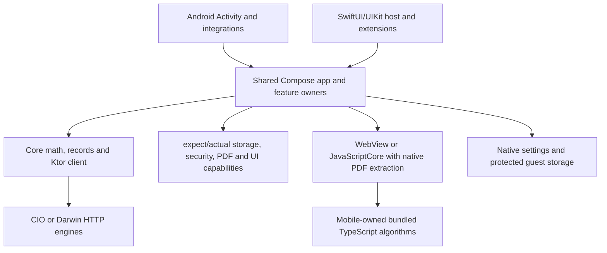

# INZIRA KMP codebase maintainability audit

Date: **15 November 2026**. Branch: `main`. Committed baseline: `80a6c88`.

## Scope, evidence and limitations

This is a **mobile-only engineering audit**, not a production refactor. No Spring Boot backend or website was changed, run or deployed. The mobile-owned TypeScript snapshot, packaged JavaScript engines, native extensions, build scripts and CI were inspected because they ship with or build the mobile app; the sibling website was not inspected as an implementation source.

The starting working tree already contained the preceding uncommitted responsibility refactor: new feature owners and tests, changed screens/model/API interface, and architecture documentation. This report describes **that actual working tree**, not an assertion that all those files exist at committed HEAD. Those changes are preserved unstaged. This audit adds only this document. Consequently, some links to extracted owners will resolve locally before they resolve on the remote branch.

Method: enumerate all mobile Kotlin/Swift and mobile-owned TypeScript files, source sets, build dependencies, declarations and large block-bodied functions; manually trace session/startup, navigation, feature commands, guest durability, financial projections, reports, PDF extraction, platform bridges and existing tests. Source inventories cover **454 Kotlin/Swift files and 11 mobile-owned TypeScript files**. This is evidence-driven architectural review, not exhaustive formal verification or a measured runtime performance profile. Counts include comments/blank lines; function spans include nested lambdas and are not cyclomatic-complexity measurements.

**Baseline result: partially failing.** Android build, host tests, Kotlin iOS compilation, complete unsigned iOS app build and shared native tests pass. One core native test fails and also fails in an untouched export of HEAD; see the exact verification record below. No Critical issue was established. High findings indicate material growth/reliability risks, not a claim of a currently exploited security defect.

## Actual implementation map

| Area | Observed implementation |
|---|---|
| Gradle modules | `:app:androidApp` → `:app:shared` → `:core`; `:server` is a separate optional Ktor starter included in settings and is not a mobile dependency. No mobile module depends on the Spring backend source. |
| `core` targets/source sets | Android, JVM, iOS arm64 and iOS simulator arm64. `commonMain` (21 Kotlin files), `androidMain` (2), `jvmMain` (2), `iosMain` (2); `commonTest` (17), `jvmTest` (1 explicit local-API check entry point), `androidHostTest` (1). Hierarchical native/iOS sets are supplied by KMP. |
| Shared targets/source sets | Android, iOS arm64 and simulator arm64; **no shared JVM target**. `commonMain` (227 Kotlin files), `androidMain` (17), `iosMain` (21), `commonTest` (71), `androidHostTest` (2), `iosTest` (7). Empty `jvmMain`/`jvmTest` directories exist but contain no Kotlin files; do not mistake them for tested targets. |
| Native hosts | Android `main` (10 Kotlin files), `debug` (2), `androidTest` (34 including helpers); 17 Swift files across iOS app, share import, widget/shared projection and Live Activity. |
| UI/state | Compose Multiplatform/Material 3, shared screens, Android Activity host and SwiftUI/UIKit iOS host/extensions. `PortfolioModel : ViewModel`, `viewModelScope`, Compose `mutableStateOf`/derived state, screen-local `remember`/`rememberSaveable`. No production Flow/StateFlow-based screen state layer found. Compose state is a valid existing choice, not itself a defect. |
| Dependency injection | Manual constructor/function/host-interface injection; composition in `App.kt`, native `remember…` factories and expect/actual ports. No Koin/Hilt container. An additional DI framework is not required to address these findings. |
| Networking | Shared Ktor `PortfolioApi` / `PortfolioDataApi`; CIO on Android/JVM, Darwin on iOS; cookie/session storage, redirects disabled, timeouts, bounded bodies and path/origin checks. Guest quote transport is separate and redistribution-disabled by default. |
| Persistence | Settings in SharedPreferences/NSUserDefaults; authenticated sign-in in native protected vaults; personal guest JSON snapshot and separate protected PDFs through native storage ports, serialized repository writes, schema validation, encrypted backups and deletion recovery. No Room/SQLDelight mobile database. Account records are remote; caches are mainly session memory. |
| Parsing/calculation | Mobile TypeScript source snapshot → checked-in ESM/portable bundle. Android WebView/PDF.js/Tesseract pipeline; iOS JavaScriptCore plus PDFKit/Vision extraction. Kotlin core owns current valuation, grouping, bond tracking and pending estimates; native decimal implementations protect important monetary boundaries. |
| Build versions | Gradle 9.1.0, AGP 9.0.0, Kotlin 2.3.21, Compose Multiplatform 1.11.1, Material 3 1.11.0-alpha07, Ktor 3.6.0, coroutines 1.10.2. Android min/target/compile 24/36/36; Java target 11, build JDK 21. Versions are observations, not an instruction to upgrade. |
| Release setup | Shared `Version.xcconfig`, environment-only upload signing, release minification/resource shrinking, optional Google Services plugin when configuration exists. iOS Xcode project plus scripts embedding framework/extensions. |
| Existing gates | Host/core tests, Android instrumentation sources, seven iOS-specific test files, Node parser/projection tests, Python build/color/package tests, release Android lint. No configured Detekt/ktlint/architecture dependency gate or coverage-percentage gate found. |

Configuration evidence: [settings](../../settings.gradle.kts), [shared build](../../app/shared/build.gradle.kts), [core build](../../core/build.gradle.kts), [Android build](../../app/androidApp/build.gradle.kts), [versions](../../gradle/libs.versions.toml), [composition root](../../app/shared/src/commonMain/kotlin/dev/orestegabo/portfolio/App.kt).

## Top 20 findings, in recommended execution order

The numbers are execution priorities, not automatic deadlines. Details below include evidence, proposed scope, complexity and regression risk. Complexity: S ≈ up to two engineering days, M ≈ several days, L ≈ one or more weeks including regression work; these are planning estimates, not commitments.

| Order / ID | Severity | Finding | Complexity | Regression risk |
|---|---|---|---|---|
| 1 / F01 | High | iOS monetary boundary violates the current exact-result contract | M | High |
| 2 / F02 | High | Automatic CI omits native tests and Android device suites | M | Low–Medium |
| 3 / F03 | High | Parser regeneration depends on an external developer checkout/toolchain | M | High |
| 4 / F04 | High | Session ViewModel remains a broad feature/command coordinator | L | High |
| 5 / F05 | High | Navigation is an implicit state machine of independent nullable/boolean fields | L | High |
| 6 / F06 | High | Mutable JSON is the domain and observable-state contract | L, incremental | High |
| 7 / F07 | High | Capture protection depends on private OS implementation details | M–L | High |
| 8 / F08 | Medium | Purchase validation and transport payload assembly live inside composables | M | Medium |
| 9 / F09 | Medium | Data/domain/presentation share a broad, unenforced source/package boundary | M–L | Medium |
| 10 / F10 | Medium | Projection and current-value calculations have different numeric policies | M–L | High |
| 11 / F11 | Medium | Financial “today” is not reactive everywhere; form defaults freeze at class load | S–M | Medium |
| 12 / F12 | Medium | Process-global native bridges retain host callbacks and mutable state | M | Medium–High |
| 13 / F13 | Medium | Native synchronous OCR/JS cannot honor coroutine timeout immediately | M | Medium–High |
| 14 / F14 | Medium | Report input loading inconsistently handles auth errors and dispatcher injection | S | Medium |
| 15 / F15 | Medium | Duplicate PDF lookup can download/hash many full documents | M | Medium |
| 16 / F16 | Medium | Shared command gateways silently reject work and expose no outcome | M | Medium–High |
| 17 / F17 | Medium | Guest writes/backup operations scale with the whole workspace | M–L | High |
| 18 / F18 | Medium | Broad ports mix capabilities with silent/default unsupported implementations | M | Medium |
| 19 / F19 | Medium | Error semantics are coupled to literal UI phrases | M | Medium |
| 20 / F20 | Low | Static quality signals are not a maintained regression budget | S–M | Low |

## Detailed findings

### F01 — High: native decimal result contract fails on iOS

**Location/evidence:** [DecimalAmount.ios.kt, `decimalAmount`](../../core/src/iosMain/kotlin/dev/orestegabo/portfolio/investments/DecimalAmount.ios.kt#L7), [ShareCompanyRows.kt, `shareCompanyRows`](../../core/src/commonMain/kotlin/dev/orestegabo/portfolio/investments/ShareCompanyRows.kt#L4), [ShareCompanyRowsTest.kt:25](../../core/src/commonTest/kotlin/dev/orestegabo/portfolio/investments/ShareCompanyRowsTest.kt#L25). The native test `remainingSharesAndTheirCostAreUsedAfterSales` expects `102523.68` and receives `102523.68000000001`; JVM passes. iOS returns `NSDecimalNumber.doubleValue` after decimal rounding, while JVM uses BigDecimal and converts to Double. The implementation, consumer and test are byte-identical to HEAD, and the failure was independently reproduced there.

**Why it matters:** this is a real cross-target contract/test failure at a financial boundary. The observed discrepancy is binary floating-point representation, not evidence that a broker charge is wrong by a cent. Exact equality is also used elsewhere, for example share-price validation. Silencing the assertion alone would leave the contract undefined.

**Recommended refactoring:** define the returned monetary representation and equality policy first. Prefer a typed minor-unit/decimal boundary for monetary outputs while keeping explicit rate/ratio types; migrate adapters without changing saved wire values. If Double must remain, validate canonical cent conversion and use documented monetary comparisons/tolerances with cross-target goldens. Cover partial sales, aggregation, negative amounts, half-cent rounding and maximum supported values.

**Complexity / risk / order:** M; High financial regression risk; **1**, before financial representation or grouping work.

### F02 — High: native and device tests are absent from automatic CI

**Location/evidence:** [mobile-release-checks.yml:38–76](../../.github/workflows/mobile-release-checks.yml#L38). Push/PR runs core JVM, shared Android host tests, scripts, lint and Android release bundle. iOS runs only through a manually selected `workflow_dispatch` option and only builds/checks packaging; it does not run `iosSimulatorArm64Test`. No connected Android instrumentation task is in this workflow. F01 passed the existing automatic test combination and failed immediately on native.

**Why it matters:** separate decimal, PDF/OCR, storage and platform effects can regress while the normal gate stays green. Compilation cannot validate native financial behavior or lifecycle handling.

**Recommended refactoring:** first preserve/report the known F01 baseline, then enable core/shared simulator tests on an automatic macOS lane. Add a bounded Android emulator smoke lane for existing import, navigation, privacy and guest tests, with full suites scheduled/manual if runtime is excessive. Keep physical lock/push/capture verification distinct from emulator tests.

**Complexity / risk / order:** M; Low–Medium CI/resource risk; **2**, before expanding refactors.

### F03 — High: rebuilding the shipped parser is not self-contained

**Location/evidence:** [sync-web-logic.mjs:6](../../scripts/sync-web-logic.mjs#L6), [bundle-shared-logic.mjs:6–8](../../scripts/bundle-shared-logic.mjs#L6). Both default to `/Users/muhirwagabooreste/WebstormProjects/gabo`; TypeScript is resolved through that checkout's `package.json`. Sync copies website TypeScript and OCR packages/assets. Bundle regeneration uses the mobile snapshot but still borrows the external TypeScript installation. The mobile CI tests checked-in JS artifacts, not a pinned regeneration from mobile source.

**Why it matters:** normal app builds work from checked-in assets, so this is **not a runtime website dependency**. The risk is irreproducible parser changes, tool/version drift and source/bundle divergence when another engineer regenerates assets.

**Recommended refactoring:** introduce a mobile-owned locked build toolchain, explicit source manifest and artifact hashes; separate optional source synchronization from reproducible bundling. In CI, rebuild to a temporary directory and compare shipped outputs, then run existing parser/bundle goldens. Preserve OCR licences and source provenance. No website/backend modification is required.

**Complexity / risk / order:** M; High parser/artifact regression risk; **3**.

### F04 — High: `PortfolioModel` still owns multiple reasons to change

**Location/evidence:** [PortfolioModel.kt:21](../../app/shared/src/commonMain/kotlin/dev/orestegabo/portfolio/investments/PortfolioModel.kt#L21), **1,118 file lines**. Despite useful extracted imports/reports/market/privacy owners, it still combines authentication and vault rotation (`unlock`), lifecycle locks, guest migration, ledger CRUD, coupon receipts, share-order CRUD, statement reconciliation, target persistence, startup synchronization, report/export commands and route flags. Anonymous feature-host adapters also live here; UI can still obtain its public concrete `api`.

**Why it matters:** feature changes require knowledge of session generations, global busy state, ordering and cleanup. The cost is not line count alone: constructors, `clearPrivateData`, startup and command handling form a shared change surface across unrelated features.

**Recommended refactoring:** keep one explicit session/lifecycle owner and security ordering. Extract ledger, share-order and reconciliation application services behind narrow ports; give screens feature-specific immutable state/actions. Keep the compatibility facade during migration, then restrict its API and client visibility. Add transition tests before moving auth/cleanup. Do not replace it with a collection of helpers that all require the entire model.

**Complexity / risk / order:** L; High session/security risk; **4**, after gates and contract characterization.

### F05 — High: navigation has no explicit valid-state model

**Location/evidence:** [InvestmentApp.kt:38–500](../../app/shared/src/commonMain/kotlin/dev/orestegabo/portfolio/investments/InvestmentApp.kt#L38). `InvestmentApp` is a **463-line composable**. Independent state includes details/editors/import review, pending entry, notification panel, report/security routes, education/tools, coupons/history and document selection. Multiple entry helpers clear partially overlapping sets. `childScreen`, the nested `back` chain, screen-title selection and render selection encode the same route precedence in different places; tab/panel routes use strings.

**Why it matters:** adding one screen can leave an older flag active or disagree about Back/title/deep-link precedence. Security and incoming-file gates are interleaved with UI selection, so a naive navigation rewrite is risky.

**Recommended refactoring:** characterize incoming PDF/widget/notification events during locked/onboarding/edit states. Introduce sealed root and child destinations with IDs/typed arguments and an explicit reducer/back transition table. Preserve gate priority as a single tested policy; avoid persisting PDFs or full financial records in saved routes. A navigation library is optional.

**Complexity / risk / order:** L; High; **5**, coordinate with F04 but migrate one route family at a time.

### F06 — High: mutable JSON is also the domain/state model

**Location/evidence:** [JsonRecord.kt:6–28](../../core/src/commonMain/kotlin/dev/orestegabo/portfolio/investments/JsonRecord.kt#L6), [PortfolioSnapshot.kt:6](../../core/src/commonMain/kotlin/dev/orestegabo/portfolio/investments/PortfolioSnapshot.kt#L6), [PurchaseReviewState.kt:4](../../app/shared/src/commonMain/kotlin/dev/orestegabo/portfolio/investments/PurchaseReviewState.kt#L4). A mutable `put`-based record represents user, bond, equity lot, pending order, document and error payloads. Accessors silently provide empty strings/defaults or NaN; integer reads truncate Double. `PortfolioSnapshot` has read-only list properties but mutable elements. Dashboard `remember` keys use snapshot/record identity.

**Why it matters:** keys, units and legal status combinations are runtime conventions. An in-place record mutation is not a Compose snapshot write and cannot reliably invalidate derived state. Many callers correctly clone records today; that discipline is not enforced. This is primitive obsession/data clumping, not evidence that every existing screen is stale.

**Recommended refactoring:** keep lossless JSON at transport/parser boundaries; map incrementally to immutable typed IDs, dates, statuses, money/rates and feature read models. Validate required fields once and preserve unknown parser evidence separately. Start with read-only share positions/quotes, then commands; do not rewrite the entire API contract at once or annotate mutable JSON as stable.

**Complexity / risk / order:** L incremental; High; **6**.

### F07 — High: capture protection relies on private OS internals

**Location/evidence:** [ExperimentalCaptureLayer.kt:19,49](../../app/androidApp/src/main/kotlin/dev/orestegabo/portfolio/ExperimentalCaptureLayer.kt#L19) invokes hidden `SurfaceControl.Transaction.setSkipScreenshot` via HiddenApiBypass; [MainActivity.kt](../../app/androidApp/src/main/kotlin/dev/orestegabo/portfolio/MainActivity.kt) installs it without a debug-only condition. [Android build:58](../../app/androidApp/build.gradle.kts#L58) uses a normal `implementation` dependency. [CaptureShieldViewController.swift:83–131](../../app/iosApp/iosApp/CaptureShieldViewController.swift#L83) locates a secure text field subview by `TextLayoutCanvasView` suffix.

**Why it matters:** OS/OEM changes can invalidate these rendering assumptions and affect masking/performance. Existing secure-window/redacted fallbacks are valuable; this audit found **no proof of a current screenshot leak**. Documentation calling the Android layer debug-only is inconsistent with current source (F23).

**Recommended refactoring:** place each workaround behind a clearly named platform capability/policy adapter; document actual release inclusion and fallback behavior. Add OS/device-matrix checks for installation failure, backgrounding, rotation, accessibility and view destruction. Make reliance on unsupported APIs an explicit release decision, preserving fail-closed behavior during any change.

**Complexity / risk / order:** M–L; High privacy/rendering risk; **7**, before altering capture paths or OS targets.

### F08 — Medium: composables validate and construct investment commands

**Location/evidence:** [PurchaseForms.kt:53–190](../../app/shared/src/commonMain/kotlin/dev/orestegabo/portfolio/investments/PurchaseForms.kt#L53) parses dates, validates face value, converts percentage units, assigns statuses and builds request JSON in `onClick`; cash preview uses `face * price / 100 + accrued + fees`. [ShareOrderScreen.kt:30](../../app/shared/src/commonMain/kotlin/dev/orestegabo/portfolio/investments/ShareOrderScreen.kt#L30) selects quote/order pricing, parses quantity, assembles versioned order JSON and supplies request dates. These screens do use model write gateways rather than direct HTTP.

**Why it matters:** important validation is coupled to composition and hard to test independently across manual, guest and PDF entry points; preview arithmetic bypasses the decimal boundary used elsewhere.

**Recommended refactoring:** extract typed form drafts, pure validators and command factories, including one decimal cash-preview calculation. Let composables own focus/selection/display only and dispatch validated commands. Test guest/account/import entry parity and preserve existing validation/masking.

**Complexity / risk / order:** M; Medium; **8**, use the typed boundaries introduced by F06.

### F09 — Medium: module boundaries do not enforce feature/layer boundaries

**Location/evidence:** [shared build](../../app/shared/build.gradle.kts) exposes `api(project(":core"))`; core itself mixes domain math, JSON and Ktor networking and exposes serialization/datetime/coroutines/Ktor as `api`. Most shared app code resides in one `…investments` package: screens, repository implementation/schema, report layout, domain-like calendar/statement rules and native bridge contracts. [PortfolioMarketData.kt](../../app/shared/src/commonMain/kotlin/dev/orestegabo/portfolio/investments/PortfolioMarketData.kt) reads `DATA_CACHE_MILLIS` defined at the bottom of `PortfolioModel.kt`; same-source-set `internal` visibility permits these reverse ownership dependencies.

**Why it matters:** moved files improve readability but do not prevent future UI-to-data coupling or unrelated feature access. Transport concerns remain visible to core consumers. No **Gradle module cycle** was found; callback-based host wiring is not itself a cycle.

**Recommended refactoring:** first establish package ownership and import rules for session, feature presentation, use cases, transport, persistence and platform ports. Move shared policies out of the model. Add a small dependency-rule gate. Split domain from transport modules only when actual consumer/build isolation warrants it, preserving the acyclic Android→shared→core graph.

**Complexity / risk / order:** M–L; Medium; **9**, after service contracts stabilize.

### F10 — Medium: numeric policy differs between the two financial runtimes

**Location/evidence:** [calculations.ts:96–99,304–307,332–367](../../web-logic/source/calculations.ts#L96) uses JavaScript Number, `Math.round` and unrounded intermediate products for simulator cash/coupons. [DecimalAmount.kt](../../core/src/commonMain/kotlin/dev/orestegabo/portfolio/investments/DecimalAmount.kt) specifies two-place HALF_UP native arithmetic for current monetary calculations. [PortfolioInsights.kt](../../app/shared/src/commonMain/kotlin/dev/orestegabo/portfolio/investments/PortfolioInsights.kt) also aggregates displayed accrued/next coupon values with `sumOf`.

**Why it matters:** current valuation, report values and hypothetical projection rows can use different rounding stages. Existing ESM-vs-bundle tests prove the two JS artifacts agree, not that Kotlin and JS intentionally implement the same monetary policy. Hypothetical estimates need not equal current valuations, but the intended differences should be explicit.

**Recommended refactoring:** document calculation ownership, units, rounding stages and where estimates intentionally differ. Add cross-runtime golden cases for shared concepts, boundary values and negative/half-cent inputs before changing formulas. Move display money aggregation through the agreed boundary; preserve historical amounts and do not silently “correct” stored trades.

**Complexity / risk / order:** M–L; High financial risk; **10**, after F01/F03.

### F11 — Medium: some date-sensitive state can remain on yesterday

**Location/evidence:** [Formatting.kt:10](../../app/shared/src/commonMain/kotlin/dev/orestegabo/portfolio/investments/Formatting.kt#L10) has a getter `Today` using the Rwanda subscription date; the prior UTC concern is **not present here**. However, [PurchaseForms.kt:38–51](../../app/shared/src/commonMain/kotlin/dev/orestegabo/portfolio/investments/PurchaseForms.kt#L38) stores `Today.toString()` in top-level `bondFields` initial values once. [PortfolioDashboard.kt:121–141](../../app/shared/src/commonMain/kotlin/dev/orestegabo/portfolio/investments/PortfolioDashboard.kt#L121) reads a non-observable clock getter. [CalendarScreen.kt:212](../../app/shared/src/commonMain/kotlin/dev/orestegabo/portfolio/investments/CalendarScreen.kt#L212) separately maintains a live lifecycle-aware date.

**Why it matters:** a long-running process can create a new bond with the date when the form metadata first initialized. A visible dashboard does not rerender solely because midnight passed. This matters for upcoming coupons and year/month boundaries.

**Recommended refactoring:** inject a shared business-date provider and observe it at lifecycle/midnight boundaries. Compute new-form date defaults at draft creation, not static field initialization. Test a process kept open across Kigali midnight and New Year, preserving an already-edited draft.

**Complexity / risk / order:** S–M; Medium; **11**.

### F12 — Medium: process-global bridges lack explicit host ownership

**Location/evidence:** [Notifications.kt:18–69](../../app/shared/src/commonMain/kotlin/dev/orestegabo/portfolio/investments/Notifications.kt#L18) stores device/registration state and permission/account/cleanup callbacks in `NativePushBridge`; [HomeWidgetBridge.kt:6–25](../../app/shared/src/commonMain/kotlin/dev/orestegabo/portfolio/investments/HomeWidgetBridge.kt#L6) retains save/pin callbacks and route counters. Android [MainActivity.installPush](../../app/androidApp/src/main/kotlin/dev/orestegabo/portfolio/MainActivity.kt#L24) installs lambdas capturing the activity; there is no corresponding bridge uninstall token. `AppLanguage` is also a mutable singleton with a retained settings adapter.

**Why it matters:** lifecycle replacement, tests and multiple scenes share process state. A callback can retain an old host until overwritten; route counters and registration updates have implicit lifetime. This is an ownership/test-isolation weakness, not a measured memory leak.

**Recommended refactoring:** make installation return a disposable registration scoped to the native host, or inject application-scoped adapters that do not retain activities. Separate replayable routes from platform delivery callbacks and define/reset account-scoped state explicitly. Preserve queued-event behavior during locking/startup.

**Complexity / risk / order:** M; Medium–High; **12**, alongside navigation/lifecycle characterization.

### F13 — Medium: cancellation cannot preempt synchronous native work

**Location/evidence:** [LocalInvestmentEngine.ios.kt:28–58,116–145](../../app/shared/src/iosMain/kotlin/dev/orestegabo/portfolio/investments/LocalInvestmentEngine.ios.kt#L28) wraps processing in `withTimeout(150_000)`, but JavaScriptCore `evaluateScript` is synchronous on Main and `VNImageRequestHandler.performRequests` is synchronous on the worker. `ensureActive()` is between pages, not inside a Vision request. [LocalInvestmentEngine.android.kt:75](../../app/shared/src/androidMain/kotlin/dev/orestegabo/portfolio/investments/LocalInvestmentEngine.android.kt#L75) bridges asset fallback with `runBlocking` in WebView interception.

**Why it matters:** a coroutine timeout is not a hard interrupt for those native calls. Cancel/background can wait until a call returns; synchronous JS can occupy UI time. Existing PDF/page/text/OCR limits significantly reduce the risk; no observed hang or deadlock is claimed.

**Recommended refactoring:** retain size limits and lazy engines; measure worst-case scanned fixtures. Track/cancel the active Vision request where supported, discard late results by operation ID, and isolate long JS evaluation on an appropriate dedicated owner/queue if measured necessary. Preload or use a synchronous asset adapter for the WebView callback rather than an opaque blocking coroutine bridge. Test cancellation during OCR/native work, not only before/after parsing.

**Complexity / risk / order:** M; Medium–High; **13**.

### F14 — Medium: report loading has two inconsistent contracts

**Location/evidence:** [PortfolioReports.kt:34–44](../../app/shared/src/commonMain/kotlin/dev/orestegabo/portfolio/investments/PortfolioReports.kt#L34) rethrows cancellation but catches every other coupon-receipt exception as `null`, including 401. The annual report branch rethrows 401. `portfolioPdf` also uses hardcoded `Dispatchers.Default` while `annualPdf` uses the constructor-injected `reportWorkDispatcher`.

**Why it matters:** one endpoint's rejected session can become “receipts unavailable” rather than going through the authenticated action boundary; later requests may still fail, so successful unauthorized export is not established. Tests cannot consistently control report execution scheduling through the advertised dependency.

**Recommended refactoring:** unify report-input loading with explicit required/optional/auth-failed outcomes and consistent dispatcher injection. Preserve honest “unknown evidence” semantics on optional non-auth failure. Add 401, cancellation, partial-data and injected-dispatcher tests for both report paths.

**Complexity / risk / order:** S; Medium; **14**. Can be a small isolated correction before larger extractions.

### F15 — Medium: duplicate import checking has linear PDF-download cost

**Location/evidence:** [PortfolioImports.kt:138–158](../../app/shared/src/commonMain/kotlin/dev/orestegabo/portfolio/investments/PortfolioImports.kt#L138) lists documents, narrows candidates with `duplicatePdfCandidate`, then downloads/hash-checks full PDFs until a match. Digest reuse is in-session. [PortfolioApi.kt:116–139](../../core/src/commonMain/kotlin/dev/orestegabo/portfolio/investments/PortfolioApi.kt#L116) accumulates chunks then copies into a final bounded byte array; the Android engine further base64-encodes/chunks selected PDFs.

**Why it matters:** a growing library with similar documents can cause repeated private downloads and memory allocations. Limits bound individual files, not total bytes/candidates across the check. This is a complexity finding, not a measured production slowdown or evidence that exact hashing should be removed.

**Recommended refactoring:** instrument candidate count/bytes/duration without document content; characterize a large library and preserve exact-byte matching. Centralize streaming hash/download handling and explicit user-visible cancellation/progress. Reuse reliable metadata only where the existing API provides it; any future server digest contract is a separate, out-of-scope proposal. Do not replace exact checks with filenames or silently skip candidates.

**Complexity / risk / order:** M; Medium; **15**, after protocol characterization and F03.

### F16 — Medium: command acceptance is implicit and silently lossy

**Location/evidence:** [PortfolioModel.runAction:487–511](../../app/shared/src/commonMain/kotlin/dev/orestegabo/portfolio/investments/PortfolioModel.kt#L487) returns immediately when guest/busy/locked, returns Unit and uses one `activeJob`/busy flag for many unrelated commands. [PortfolioGuestWorkspace.action:28–42](../../app/shared/src/commonMain/kotlin/dev/orestegabo/portfolio/investments/PortfolioGuestWorkspace.kt#L28) similarly declines work while backgrounded/wrong-mode/already active. The root manually gates incoming native actions against these states.

**Why it matters:** a caller cannot distinguish “accepted” from “ignored”, await a typed completion, or deliberately retry after an external event. The current serialization protects writes; replacing it with unrestricted concurrency would be a regression. UI disabling reduces, but does not encode, the acceptance contract.

**Recommended refactoring:** return an explicit accepted/rejected reason or operation handle, separate session checks from feature operation state, and centralize event retry/consumption. Keep financial writes serialized and idempotency semantics intact. Test locked/background/busy delivery and cancellation cleanup before changing the gate.

**Complexity / risk / order:** M; Medium–High; **16**, after F04/F05 transition tests.

### F17 — Medium: whole-workspace persistence/backup is the guest growth boundary

**Location/evidence:** [LocalGuestPortfolioRepository.kt:207–261,266–308](../../app/shared/src/commonMain/kotlin/dev/orestegabo/portfolio/investments/LocalGuestPortfolioRepository.kt#L207) reads/parses/validates and serializes the entire JSON workspace for updates; backup/export assembles document bytes plus base64 JSON before encryption. [GuestPortfolioRepository.kt:11](../../app/shared/src/commonMain/kotlin/dev/orestegabo/portfolio/investments/GuestPortfolioRepository.kt#L11) bounds the snapshot to 4 MiB; backup is bounded at 48 MiB. A mutex and worker dispatcher protect durable ordering.

**Why it matters:** per-write cost and backup peak memory grow with all local records, even when one receipt changes. Current limits and recovery behavior are intentional safeguards, not dead code. A database migration is not justified merely because this implementation has 328 lines.

**Recommended refactoring:** add representative maximum-workspace benchmarks and corruption/cancellation fixtures; split backup assembly from repository CRUD behind the existing durable ports. If scale requirements exceed measured bounds, introduce versioned incremental storage/streamed backup migration with rollback, ownership validation and original-PDF retention tests. Preserve encryption, deletion journal and atomic commit order.

**Complexity / risk / order:** M–L; High data-loss risk; **17**, only after measuring target scale.

### F18 — Medium: broad capability interfaces can hide incomplete adapters

**Location/evidence:** [PlatformPorts.kt:9–69](../../app/shared/src/commonMain/kotlin/dev/orestegabo/portfolio/investments/PlatformPorts.kt#L9). `ServerSettings` combines connection, session, privacy, appearance, targets and import history; most writes default to no-op. `NativeActions` combines password save, PDF/backup pick/save/share, URLs/mail and text. `InvestmentEngine.run(command: String, payload: JsonRecord, pdf: ByteArray?)` combines parser/simulator operations and has one mutable progress callback; iOS serializes operations with a mutex while Android has a pending-operation map.

**Why it matters:** capabilities and lifecycle/serialization contracts are implicit. Test fakes or future adapters can compile while silently losing preference writes or accepting unsupported command strings. The existing `InvestmentDocumentParser` port and narrow `PortfolioDataApi` are improvements to extend, not replace.

**Recommended refactoring:** introduce small required preference/capability ports as consumers migrate; make unsupported optional capabilities explicit. Use typed parser/projector operations and document single-operation ownership/progress cancellation. Keep composition manual; avoid an interface for every trivial helper or unnecessary inheritance hierarchy.

**Complexity / risk / order:** M; Medium; **18**, alongside feature extraction.

### F19 — Medium: UI copy doubles as error identity

**Location/evidence:** [UserFacingErrors.kt](../../app/shared/src/commonMain/kotlin/dev/orestegabo/portfolio/investments/UserFacingErrors.kt) allowlists exact approved phrases and a few regex patterns; 401 interpretation compares literal server error strings. [PurchaseForms.kt:157](../../app/shared/src/commonMain/kotlin/dev/orestegabo/portfolio/investments/PurchaseForms.kt#L157) constructs a validation message with `localized(field.label)`, then passes it through the allowlist boundary. [PortfolioModel:773–774](../../app/shared/src/commonMain/kotlin/dev/orestegabo/portfolio/investments/PortfolioModel.kt#L773) and optional report/history reads discard non-auth exceptions without a structured diagnostic result.

**Why it matters:** changing copy or locale can change which remediation survives to the UI. Safe generic fallbacks correctly prevent private server/PDF details from leaking, but they also collapse distinct failures and make support/feature tests depend on wording.

**Recommended refactoring:** use sealed/local error codes with structured safe arguments and a single localization mapper; keep HTTP/parsing diagnostics private and content-free. Add bounded diagnostic categories/status/operation IDs for optional failures. Preserve the existing allowlist as a compatibility fallback until callers migrate; never start showing arbitrary exception messages.

**Complexity / risk / order:** M; Medium privacy/behavior risk; **19**.

### F20 — Low: static warnings and maintainability budgets are not enforced

**Location/evidence:** [Gradle configuration](../../build.gradle.kts), [mobile workflow](../../.github/workflows/mobile-release-checks.yml). No Detekt/ktlint/complexity or architecture-rule task is configured. Executed release lint has **0 errors, 100 warnings**; categories are recorded below. Kotlin compilation additionally flags an always-true condition in `PurchaseImportScreens.kt:32`, deprecated icon/date APIs, unnecessary safe calls and `!!` in navigation/settings. `InvestmentApp` has long multi-statement lines which hide route/cleanup branches despite acceptable Kotlin compilation.

**Why it matters:** large-function growth, dependency leakage and dead branches have no automatic ratchet. A passing lint task is not “no warnings”. Update hints and duplicated launcher resources are not all actionable defects; blindly clearing them would produce churn.

**Recommended refactoring:** classify/suppress justified resource warnings narrowly, remove verified redundant branches in a separate change, and introduce formatting/dependency/complexity checks with an agreed baseline on changed code. Keep dependency updates measured and test-backed. Do not impose a blanket 500-line rule on translations, icons, vector layouts or fixtures.

**Complexity / risk / order:** S–M; Low; **20**. Formatting-only commits should remain separate from behavior changes.

## Additional concrete maintainability findings

### F21 — Medium: report formatting, policy and layout evolve together

**Location/evidence:** [PortfolioReport.kt:21–186](../../app/shared/src/commonMain/kotlin/dev/orestegabo/portfolio/investments/PortfolioReport.kt#L21) is a 166-line generator containing valuation/ledger enrichment, numeric formatting, bilingual strings and PDF section layout. [AnnualReport.kt:56–152](../../app/shared/src/commonMain/kotlin/dev/orestegabo/portfolio/investments/AnnualReport.kt#L56) repeats a local cash formatter. UI [Formatting.kt](../../app/shared/src/commonMain/kotlin/dev/orestegabo/portfolio/investments/Formatting.kt) implements another formatter. `ReportPdf` itself is a cohesive 317-line vector renderer and is not a God Object merely for drawing many primitives.

**Why it matters / recommendation:** a formatting or financial-scope change touches several outputs. Extract an immutable report read model and explicit locale-aware formatting policy, then render sections with the existing PDF writer. Preserve intentional PDF font/grouping differences and add output/rounding goldens; do not force Compose formatting into background report generation.

**Complexity / risk / execution order:** M; Medium–High report/financial presentation risk; **21**, after F10/F14.

### F22 — Medium: financial defaults lack a common versioned policy model

**Location/evidence:** [ShareOrderEstimate.kt:3](../../core/src/commonMain/kotlin/dev/orestegabo/portfolio/investments/ShareOrderEstimate.kt#L3) fixes commission at 1.71%; [PendingCouponEstimate.kt:10–22](../../core/src/commonMain/kotlin/dev/orestegabo/portfolio/investments/PendingCouponEstimate.kt#L10) has dated fallback treasury coupon points, and [PurchaseForms.kt](../../app/shared/src/commonMain/kotlin/dev/orestegabo/portfolio/investments/PurchaseForms.kt) defaults a treasury tax/coupon/frequency. The commission is an explicitly requested product policy, and pending estimates already expose `assumed`; this is not a finding that those rates are factually wrong.

**Why it matters / recommendation:** new markets/dates/instruments make scattered defaults harder to review. Introduce a small dated assumption/provenance policy with explicit units and applicability; retain recorded order/contract values when defaults change. Test saved versus estimated amounts and unavailable-rate behavior. Avoid remote-config infrastructure unless requirements justify it.

**Complexity / risk / execution order:** M; High financial policy risk; **22**, after typed money/estimate contracts.

### F23 — Medium: existing architecture notes contradict current release code

**Location/evidence:** [ARCHITECTURE.md, capture section](../ARCHITECTURE.md) says private Android capture APIs/bypass are absent from release, while current `app/androidApp/build.gradle.kts`, `MainActivity` and `ExperimentalCaptureLayer` include/install them without a debug-only gate. [TECHNICAL_DEBT.md](../TECHNICAL_DEBT.md) still begins with an October baseline and contains backend/website-era statements alongside subsequent amendments.

**Why it matters / recommendation:** a maintainer can approve a release using an incorrect dependency/privacy model. Reconcile release claims from current variant source/dependency evidence, date each resolved finding, and separate mobile facts from historical external-service observations. This audit does not rewrite those existing uncommitted documents or infer live deployment state.

**Complexity / risk / execution order:** S; Low code regression risk, meaningful review risk; **23**, update alongside F07 before a release decision.

### F24 — Low: dependency/build ownership is split across catalogs and scripts

**Location/evidence:** [Android build](../../app/androidApp/build.gradle.kts) hardcodes Firebase BoM/plugin, Fragment, desugaring, runner and HiddenApiBypass versions; [shared build](../../app/shared/build.gradle.kts) hardcodes Biometric/coroutines Android versions while related versions live in the catalog. Xcode build reports framework/share/widget/Live Activity scripts run every build because dependency analysis is disabled.

**Why it matters / recommendation:** upgrades require coordinated edits and native incremental build cost is opaque. Centralize version ownership and document why native script phases must always run; add trustworthy inputs/outputs only where signing/embedding stays correct. The catalog contains unused-looking aliases, but no runtime dependency is proven unnecessary solely by an alias search; do not remove Firebase or native adapters speculatively.

**Complexity / risk / execution order:** S–M; Low–Medium build/package risk; **24**, independently after functional gates.

## Largest files, classes and functions

### Production file inventory

A strict `>500` threshold flags only the translation map and `PortfolioModel`; `InvestmentApp` is exactly 500. `>800` and `>1000` flag the same two files, but the translation map is not a class. No additional mobile Kotlin/Swift production file exceeds those thresholds. The large TypeScript file `calculations.ts` is 478 lines; vendor/generated JS/OCR runtimes are excluded from class-size judgments.

| File | Lines | Assessment |
|---|---:|---|
| `FrenchStrings.kt` | 2,004 | Declarative translation map, not a 2,004-line behavioral class. Keep as data; typed resource migration is optional, not an urgent split. |
| `PortfolioModel.kt` | 1,118 | One dominant ViewModel; genuine responsibility breadth (F04). |
| `InvestmentApp.kt` | 500 | One dominant 463-line composable; state/route complexity (F05). |
| `PortfolioDashboard.kt` | 450 | `PortfolioScreen` is 338 lines; display, filters, actions and derived-data assembly. Extract read model/sections when changing it; existing `remember` keys already avoid some repeated work. No measured recomposition regression claimed. |
| `PortfolioImports.kt` | 408 | Complex import coordinator with receipt/retry/upload/duplicate/matching ownership; protocol-heavy, so use F15/F16/typed boundaries before further splitting. |
| `SignInScreen.kt` | 360 | 297-line composable with several auth form modes. Separate mode/draft/validation state as auth features grow, preserving autofill/credential handling. |
| `DocumentsHub.kt` | 345 | Several composables; longest import conversation is 174 lines. Primarily declarative rendering with workflow state inputs. |
| `DocumentsScreen.kt` | 335 | Multiple functions; main screen is 154 lines. Revisit feature-specific state and commands, not arbitrary file splitting. |
| `LocalGuestPortfolioRepository.kt` | 328 | Cohesive storage transaction/recovery owner; scale/backup boundary in F17. |
| `ReportPdf.kt` | 317 | Cohesive vector PDF/layout writer; no unrelated networking/session responsibility found. |
| `InvestmentChart.kt` | 302 | Drawing/hit-testing composable; 235-line drawing body is not equivalent to 235 lines of unrelated business logic. |
| `SettingsScreen.kt` | 301 | 270-line composable with multiple settings sections; use smaller capability/state contracts (F18). |
| `ShareViewController.swift` | 290 | Largest Swift source, combines input reading, staged share flow and UI. Native extension lifecycle justifies separate implementation; isolate staging/presentation further when evolving the flow. |

File paths above, unless marked Swift, are under `app/shared/src/commonMain/kotlin/dev/orestegabo/portfolio/investments/`; Swift path is `app/iosApp/ShareImport/ShareViewController.swift`.

### Largest named block-bodied Kotlin functions/composables

Spans are inclusive declaration-to-closing-brace, counted lexically with strings/comments excluded from brace matching. They include nested helpers/lambdas. Expression-bodied functions and Swift closures are not ranked by this scanner; the Swift files and native engines were reviewed separately.

| Function | File | Lines / span |
|---|---|---|
| `InvestmentApp` | [InvestmentApp.kt](../../app/shared/src/commonMain/kotlin/dev/orestegabo/portfolio/investments/InvestmentApp.kt#L38) | 463 / 38–500 |
| `PortfolioScreen` | [PortfolioDashboard.kt](../../app/shared/src/commonMain/kotlin/dev/orestegabo/portfolio/investments/PortfolioDashboard.kt#L83) | 338 / 83–420 |
| `SignInScreen` | [SignInScreen.kt](../../app/shared/src/commonMain/kotlin/dev/orestegabo/portfolio/investments/SignInScreen.kt#L64) | 297 / 64–360 |
| `SettingsScreen` | [SettingsScreen.kt](../../app/shared/src/commonMain/kotlin/dev/orestegabo/portfolio/investments/SettingsScreen.kt#L32) | 270 / 32–301 |
| `InvestmentChartContent` | [InvestmentChart.kt](../../app/shared/src/commonMain/kotlin/dev/orestegabo/portfolio/investments/InvestmentChart.kt#L68) | 235 / 68–302 |
| `CalendarScreen` | [CalendarScreen.kt](../../app/shared/src/commonMain/kotlin/dev/orestegabo/portfolio/investments/CalendarScreen.kt#L31) | 175 / 31–205 |
| `ImportConversation` | [DocumentsHub.kt](../../app/shared/src/commonMain/kotlin/dev/orestegabo/portfolio/investments/DocumentsHub.kt#L146) | 174 / 146–319 |
| `BondDetailsScreen` | [InvestmentDetails.kt](../../app/shared/src/commonMain/kotlin/dev/orestegabo/portfolio/investments/InvestmentDetails.kt#L23) | 167 / 23–189 |
| `generatePortfolioReport` | [PortfolioReport.kt](../../app/shared/src/commonMain/kotlin/dev/orestegabo/portfolio/investments/PortfolioReport.kt#L21) | 166 / 21–186 |
| `DocumentsScreen` | [DocumentsScreen.kt](../../app/shared/src/commonMain/kotlin/dev/orestegabo/portfolio/investments/DocumentsScreen.kt#L39) | 154 / 39–192 |
| `YearlyCouponsScreen` | [YearlyCouponsScreen.kt](../../app/shared/src/commonMain/kotlin/dev/orestegabo/portfolio/investments/YearlyCouponsScreen.kt#L27) | 152 / 27–178 |
| `StocksScreen` | [StocksScreen.kt](../../app/shared/src/commonMain/kotlin/dev/orestegabo/portfolio/investments/StocksScreen.kt#L57) | 149 / 57–205 |
| `PurchaseEditor` | [PurchaseForms.kt](../../app/shared/src/commonMain/kotlin/dev/orestegabo/portfolio/investments/PurchaseForms.kt#L53) | 138 / 53–190 |
| `CashLedgerScreen` | [CashLedgerScreen.kt](../../app/shared/src/commonMain/kotlin/dev/orestegabo/portfolio/investments/CashLedgerScreen.kt#L16) | 132 / 16–147 |
| `OnboardingScreen` | [OnboardingScreen.kt](../../app/shared/src/commonMain/kotlin/dev/orestegabo/portfolio/investments/OnboardingScreen.kt#L58) | 122 / 58–179 |
| `IssueReportScreen` | [IssueReportScreen.kt](../../app/shared/src/commonMain/kotlin/dev/orestegabo/portfolio/investments/IssueReportScreen.kt#L31) | 111 / 31–141 |
| `ShareOrderScreen` | [ShareOrderScreen.kt](../../app/shared/src/commonMain/kotlin/dev/orestegabo/portfolio/investments/ShareOrderScreen.kt#L30) | 110 / 30–139 |
| `SimulatorScreen` | [PlanningScreens.kt](../../app/shared/src/commonMain/kotlin/dev/orestegabo/portfolio/investments/PlanningScreens.kt#L35) | 107 / 35–141 |


## Dependency, OOP and Compose observations



- **Dependency direction:** the Gradle graph is acyclic. Core has no Compose dependency or import of app UI. Source-level app layering is weaker (F09); UI still selects/mutates transport-shaped records (F06/F08). No direct `model.api.request` remains in `*Screen.kt`/`*Screens.kt` after the pre-existing refactor, but the concrete API remains exposed on the model and domain commands still assemble JSON in UI.
- **Encapsulation/composition:** final Kotlin classes, private setters, narrow host ports, injected clocks/dispatchers, native adapters and composition are strengths. No inappropriate production inheritance hierarchy or unsafe downcast hierarchy was established. Moving native PDF/security logic into common code merely to remove duplication would be inappropriate.
- **God Object / Feature Envy / Data Clumps:** F04 is the remaining broad coordinator. Repeated `row.text("…")`/`optDouble` chains across forms, review/matching, reports and screens are concrete feature-envy/data-clump signals around records without domain behavior (F06). They justify typed feature models, not one method-heavy universal investment class.
- **SOLID:** SRP pressure is concentrated in F04/F05/F08/F21. Open/closed and dependency inversion already benefit from storage/parser/transport ports, but new broker layouts and record kinds still require string branches across consumers. Interface segregation is weakest at platform/settings ports (F18). F01 and differing engine serialization highlight contracts needing characterization; no broad Liskov violation is inferred simply because implementations differ internally.
- **Compose ownership:** ViewModel-owned Compose state is legitimate. Large screen signatures and reads of the whole model make ownership less explicit. Dashboard computations are partly memoized; mutable JSON identity (F06), non-observable dates (F11), and root route effects (F05/F12) are stronger evidence than speculation about recomposition count. No tracing/benchmark showed unnecessary recompositions, so none are claimed as measured defects.
- **Coroutines/resources:** existing code generally rethrows `CancellationException`, uses `viewModelScope`, locks guest writes and sync operations, closes clients/native streams, disposes engines and bounds PDFs/thumbnails. Generation checks prevent several stale-result classes and existing tests exercise them. Remaining concerns are explicit command acceptance, synchronous native cancellation, process callback ownership and inconsistent optional-error policy—not a blanket absence of structured concurrency.
- **Reliability boundaries worth preserving:** HTTPS/origin/path validation, disabled redirects, response limits, parser active-content rejection, page/text/OCR budgets, safe user-facing error filtering, masked capture fallbacks, separate guest/account state, owner-scoped client paths, durable guest recovery and original PDF retention. No app-side refactor should weaken those checks to reduce code size.
- **No blanket cleanup:** vendor OCR/PDF assets, generated icon vectors, translations, fixtures and the existing backup/delete recovery paths are not dead code merely because they are large. This audit found no defensible reason to remove them. It does not claim every unused dependency or unreachable branch has been proven absent.

## Suggested refactoring sequence and acceptance criteria

1. **Establish trustworthy gates (F01–F03).** Resolve native monetary output/comparison semantics with cross-target tests, automate native/device smoke coverage, and make parser regeneration reproducible. Keep historical wire formats and financial values stable.
2. **Characterize state transitions before moving ownership (F04–F07, F12, F16).** Lock/logout/background/guest/account/origin-switch scenarios; incoming PDF, notification and widget routes during busy/onboarding/edit states; capture capability loss. Preserve one session authority and explicit navigation priority.
3. **Migrate one feature slice (F06, F08, F09, F18).** Start with read-only share/quote models, then typed form drafts/commands and ledger/share-order services. Expose feature state/actions to screens; retain a compatibility facade until all callers migrate. Enforce package dependency rules before adding modules.
4. **Consolidate financial/presentation policies (F10, F11, F14, F19, F21, F22).** Shared business-date source, typed safe errors, report input model and decimal aggregations. Golden-test Kotlin/native/JS and PDF/UI values where concepts overlap; document intentional estimate differences.
5. **Scale using measurements (F13, F15, F17).** Large library/workspace/backup fixtures, OCR cancellation and memory budgets. Preserve exact-byte duplicate checks, atomic storage and retry outcomes. Treat any future backend/API proposal as separate authorization/scope.
6. **Ratchet readability and build hygiene (F20, F23, F24).** Correct release documentation, format touched code separately, classify warning budget and centralize version ownership. Avoid mixing mechanical formatting with behavior fixes.

For each slice: keep commits focused, retain original regression tests, add tests for changed contracts, build Android/iOS, and verify affected native workflows. Do not undertake a whole-app “clean architecture” rewrite or force all files below an arbitrary size.

## Existing automated coverage and gaps

**Observed strengths:** core valuation/grouping/partial sales, bond schedules and pending estimates; secure-session/background/privacy policy; guest storage/backup/recovery/migration; import duplicate/retry/evidence matching; reports; localization; cancellation and caches. Android instrumentation sources cover actual WebView/PDF rendering, import conversation, guest/UI flows, capture, widgets, notifications and calendar. iOS tests exercise native engine/OCR, storage, rendering, shared inbox, backup crypto, layout and report writing. Node tests include JS parser/projection artifact parity. These are substantial tests, not an untested application.

**Gaps demonstrated by source/gates, without inventing a coverage percentage:**

| Gap | Evidence / needed test |
|---|---|
| Cross-target money contract | F01's native failure despite passing JVM. Expand native/JVM goldens and explicit representation assertions. |
| Automatic native/device execution | F02. Existing instrumentation/native source presence does not mean PRs run it. |
| Explicit root navigation state | No exhaustive reducer/valid-state model exists; add transition matrix for simultaneously queued external events, Back, lock and interrupted imports. Existing notification routing/guest/navigation tests cover selected scenarios, not every root flag combination. |
| Report optional/auth/dispatcher parity | F14; existing PDF/report tests do not establish the two loaders handle 401 and injection identically. |
| Long-lived business date | Existing date/calendar tests validate helpers; add process-kept-alive form/dashboard rollover and user-edited draft preservation (F11). |
| Source-to-generated parser provenance | ESM/bundle parity tests use generated outputs; add locked regeneration/diff gate (F03). |
| Scale and native interruption | Thumbnail cache has memory-bound tests, but no automated suite establishes a whole-app heap budget for many candidate PDF downloads, maximum backup/workspace and cancellation during a blocking native call. |
| Real-device privacy/push matrix | Emulators/simulators cannot prove all OEM capture behavior, locked-device vault behavior, APNs/FCM background delivery or production credentials. This audit sends no real push, imports no account data and changes no live records. |
| Dependency/complexity regressions | No import-layer/static complexity ratchet or measured coverage report configured. Numeric coverage percentages would be unsupported. |

## Baseline build, test and static verification

All commands below were executed during this audit from repository root unless noted. Commands required host tool/cache access; the first non-elevated `simctl list devices booted` could not access CoreSimulatorService under the sandbox. Repeating with permitted host access succeeded. That was an environment access error, not a product test failure.

Environment used: macOS arm64, Xcode installed at `/Applications/Xcode.app`, JDK `/Users/muhirwagabooreste/Library/Java/JavaVirtualMachines/ms-21.0.9/Contents/Home`, existing Android SDK `/Users/muhirwagabooreste/Library/Android/sdk`. Gradle wrapper/settings select the repository versions above.

### Android, shared/core host tests and Kotlin iOS compilation

```sh
JAVA_HOME=/Users/muhirwagabooreste/Library/Java/JavaVirtualMachines/ms-21.0.9/Contents/Home ./gradlew :core:jvmTest :app:shared:testAndroidHostTest :app:androidApp:assembleDebug :app:androidApp:lintRelease :app:shared:compileKotlinIosArm64 :app:shared:compileKotlinIosSimulatorArm64 --console=plain
```

**Result:** exit 0, `BUILD SUCCESSFUL in 32s`, 141 actionable tasks (26 executed, 4 from cache, 111 up-to-date). Android debug APK compiled; release lint and both iOS shared compilations passed. Core is compiled as a dependency of the shared targets. To ensure host test execution rather than only reusing up-to-date results:

```sh
JAVA_HOME=/Users/muhirwagabooreste/Library/Java/JavaVirtualMachines/ms-21.0.9/Contents/Home ./gradlew :core:jvmTest --rerun :app:shared:testAndroidHostTest --rerun --console=plain
```

**Result:** exit 0, `BUILD SUCCESSFUL in 4s`. Fresh XML totals: **89 core JVM tests + 409 shared Android host tests; 0 failures/errors/skips**. Logs: `/tmp/inzira-kmp-audit-gradle.log`, `/tmp/inzira-kmp-audit-host-rerun.log`. XML is under `core/build/test-results/jvmTest` and `app/shared/build/test-results/testAndroidHostTest`.

### iOS simulator tests — one confirmed pre-existing failure

```sh
xcrun simctl list devices booted
xcrun simctl list devices available
xcrun simctl boot 1726E7D8-877B-4A6D-ABCD-7292D35D5BD4
xcrun simctl bootstatus 1726E7D8-877B-4A6D-ABCD-7292D35D5BD4 -b
JAVA_HOME=/Users/muhirwagabooreste/Library/Java/JavaVirtualMachines/ms-21.0.9/Contents/Home ./gradlew :core:iosSimulatorArm64Test :app:shared:iosSimulatorArm64Test -PiosTestDevice=1726E7D8-877B-4A6D-ABCD-7292D35D5BD4 --continue --console=plain
```

Device: existing iPhone 16 Pro simulator, iOS 18.6. **Result:** overall exit 1, `BUILD FAILED in 40s`; **core 89 tests, 1 failure; shared 432 tests, 0 failures/errors/skips**. The shared task ran because `--continue` was supplied. Core failure:

```text
ShareCompanyRowsTest.remainingSharesAndTheirCostAreUsedAfterSales[iosSimulatorArm64]
kotlin.AssertionError: Expected <102523.68>, actual <102523.68000000001>.
```

Log: `/tmp/inzira-kmp-audit-native.log`. XML: `core/build/test-results/iosSimulatorArm64Test` and `app/shared/build/test-results/iosSimulatorArm64Test`. No failing assertion was edited or excluded.

**Pre-existing baseline confirmation:** the implementation/consumer/test listed in F01 match `git show HEAD:<path>` byte-for-byte. Additionally, this command exported committed HEAD without including any uncommitted refactor and reran the native core suite:

```sh
audit_baseline=$(mktemp -d /tmp/inzira-kmp-audit-head.XXXXXX)
git archive HEAD | tar -x -C "$audit_baseline"
printf '%s\n' "$audit_baseline" > /tmp/inzira-kmp-audit-baseline-path.txt
JAVA_HOME=/Users/muhirwagabooreste/Library/Java/JavaVirtualMachines/ms-21.0.9/Contents/Home ANDROID_HOME=/Users/muhirwagabooreste/Library/Android/sdk ./gradlew --project-dir "$audit_baseline" :core:iosSimulatorArm64Test --console=plain
```

**Result:** exit 1, `BUILD FAILED in 2s`, same **89 tests / same single failing assertion**. Compilation/link outputs were cache hits; test execution reran. Export used: `/tmp/inzira-kmp-audit-head.4t98UG`. Evidence log: `/tmp/inzira-kmp-audit-head-native.log`. The pre-existing-failure exception in the audit request therefore permits committing this documentation alone; it does **not** make native verification green.

### Complete iOS app/extensions build

```sh
JAVA_HOME=/Users/muhirwagabooreste/Library/Java/JavaVirtualMachines/ms-21.0.9/Contents/Home xcodebuild -project app/iosApp/iosApp.xcodeproj -scheme iosApp -configuration Debug -destination 'generic/platform=iOS' -derivedDataPath /tmp/inzira-kmp-audit-ios CODE_SIGNING_ALLOWED=NO build
```

**Result:** exit 0, `BUILD SUCCEEDED`, including framework and embedding share/widget/optional activity products. Build notes say the four script phases run every build (F24). Log: `/tmp/inzira-kmp-audit-xcode.log`. This is unsigned device-target build verification; no physical iPhone install, signing/distribution check or new hardware test was performed.

### Mobile engine/script/static checks

```sh
node --test tests/*.test.mjs
python3 -m unittest discover -s scripts/tests -p 'test_*.py'
python3 scripts/sync-design-colors.py --check
git diff --check
```

**Results:** Node **84 passed, 0 failed/skipped**; Python **13 passed**; design-color check exit 0; diff whitespace check exit 0. Logs: `/tmp/inzira-kmp-audit-node.log`, `/tmp/inzira-kmp-audit-python.log`, `/tmp/inzira-kmp-audit-colors.log`. These commands do not regenerate production assets.

Release lint XML: `app/androidApp/build/reports/lint-results-release.xml`. **0 errors, 100 warnings:** 25 `NewerVersionAvailable`, 20 `IconLauncherShape`, 12 `UnusedAttribute`, 10 `IconDuplicates`, 10 `UseKtx`, 6 `UseTomlInstead`, 5 `GradleDependency`, 3 `AndroidGradlePluginVersion`, 2 each `OldTargetApi`, `UseCompoundDrawables`, `NestedWeights`, `MonochromeLauncherIcon`, and 1 `ObsoleteSdkInt`. Update suggestions are not vulnerability findings; duplicated round/standard icon assets may be intentional.

**Not executed in this audit:** Android connected instrumentation/UI suites, physical-device flows, release bundle/signing/store submission, network smoke checks against live accounts/backend, production APNs/FCM delivery, full heap/recomposition profiling, or a Detekt/ktlint task (none is configured). Earlier chat test runs are not substituted for fresh verification here. This is not a claim that all possible checks passed.

## Audit-change review and handoff

All 454 Kotlin/Swift files were hashed at the beginning and compared after verification: unchanged by this audit. No parser/assets, production build configuration, backend or website source was edited. The existing production refactor/tests/other documentation remain uncommitted and are outside this documentation commit.

Review/stage only `docs/quality/KMP_CODEBASE_AUDIT.md`; check its staged diff and whitespace, commit as `docs(kmp): audit codebase maintainability`, then push the current branch. The native baseline failure remains an explicitly unresolved F01 finding. Evidence logs/build artifacts in `/tmp` and ignored build directories are local diagnostics, not committed source or a durable CI artifact archive.
