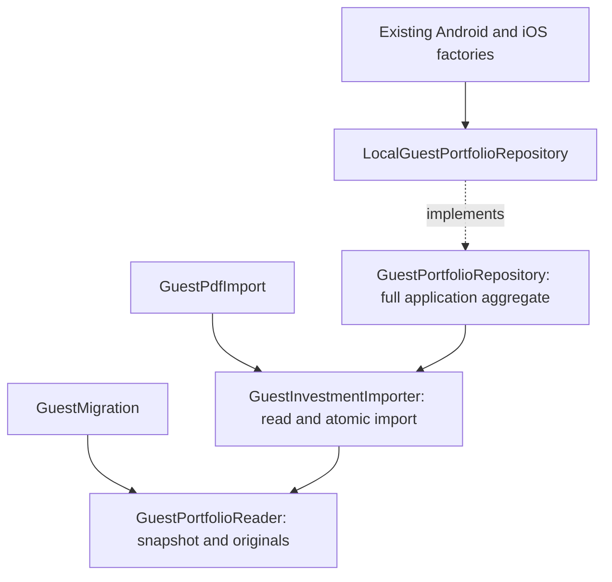

# Interface Segregation Principle review

Reviewed against `3a79708` and the working tree on 15 November 2026. Scope: mobile KMP contracts, implementations, callers and manual DI. Backend, website, persistence schemas, financial calculations and build configuration are unchanged. Earlier unfinished extractions remain outside this commit.

## Consumer-to-capability audit

| Contract / consumer | Actual dependency | Decision |
|---|---|---|
| `GuestPortfolioRepository` → `GuestMigration` | Only `load` and `documentBytes`; remote transfer is already behind `GuestMigrationRemote`. Migration never writes the local repository. | Depend on new **`GuestPortfolioReader`**. The local side can no longer expose delete, edit, import, ledger or restore operations through this dependency. |
| `GuestPortfolioRepository` → `GuestPdfImport` | `load`, `documentBytes` and `importPdf`; no standalone holding edits, deletion, ledger, target or archive operations. | Depend on new **`GuestInvestmentImporter`**, combining read access with the existing atomic import operation. |
| Full guest repository at composition/session owner | Coordinates all guest operations and supplies both workflows. The common implementation genuinely implements the full set. | Retain **`GuestPortfolioRepository`** as an aggregate extending the import capability. Do not split the atomic persistence implementation into independently committed files/records. |
| `NativeActions` / `PdfPicker` | The picker/parser pipeline already uses `PdfPicker`; platform/root UI still wires the device-action aggregate. | Preserve the existing narrow picker contract and full host wiring. Do not add one interface for every UI action or retrofit all unrelated tests. Optional native capability limitations are recorded by the preceding LSP review. |
| `GuestSnapshotStorage`, `GuestDocumentStorage` | Native adapters provide cohesive durable snapshot and document operations. | Preserve them. Reading and atomic writing are related storage duties; splitting them without distinct consumers would add wiring rather than improve ownership. |
| `InvestmentDocumentParser`, `PdfDocumentPages` | Parsing/progress/cancellation, or page count/rendering/resource release, respectively. | Preserve cohesive lifecycle contracts; rendering should retain access to the resource it must close. |
| `PortfolioDataApi`, `GuestMigrationRemote` | Data access without session ownership; or remote migration status/document/item operations. | Preserve current focused ports. Account workflows perform reads and writes, while migration remote methods share the same account/transfer responsibility. No extra transport interface per HTTP verb. |
| `ServerSettings` | Broad preference aggregate; some feature consumers use only a small subset. Existing defaults deliberately permit partial hosts. | Candidate for subsequent consumer-based segregation. Do not promote optional no-op preferences into a falsely durable store contract or require dozens of meaningless test implementations in this slice. |

Production guest repositories are not forced to supply meaningless methods: there is one shared implementation used by both native factories. The problem corrected here is that specialized consumers and their test doubles depended on its unrelated full surface.

## Resulting contracts

`GuestPortfolioCapabilities.kt` introduces two focused capabilities:

- `GuestPortfolioReader`: `load(): GuestPortfolio`, `documentBytes(id): ByteArray`.
- `GuestInvestmentImporter : GuestPortfolioReader`: adds `importPdf(bytes, fileName, kind, body, targetId = null): GuestPortfolio`.

The full repository extends `GuestInvestmentImporter`. Its three matching declarations move into the capabilities without signature, nullability or default-argument changes. All other repository operations remain required, including the ledger/archive methods strengthened in the prior LSP change. This is a three-method import surface, not one tiny interface for every repository operation.

`GuestMigration` now requires two methods instead of the original sixteen-method aggregate. `GuestPdfImport` requires three. Neither uses runtime capability checks, casts, nullable adapters or an unsupported-operation fallback. Read methods retain the same detached-value semantics and missing-document/storage error behavior as before.



## Implementation, DI and compatibility

The common concrete repository and native factories are untouched. They still construct one owner with protected snapshot/document stores and return `GuestPortfolioRepository`. Existing model/composition code passes that same object to both specialized constructors; normal subtyping supplies the narrower contract. No new object, wrapper, DI registration, Gradle module or platform-specific interface is introduced.

Only constructor dependency types change in the two consumers. Their method bodies, action guards, validation, cancellation, consent, revision checks, duplicate evidence logic, transfer ordering, PDF zeroing and atomic save behavior remain unchanged. Source comparison verifies this directly. Public repository calls retain inherited members/default arguments, and existing call sites compile with the same expressions.

All targets rebuild together. Binary compatibility with separately compiled external implementations or callers of the changed public import-workflow constructor is not claimed; the app does not publish these as an independent SDK. No Swift host source directly instantiates that workflow.

The full aggregate intentionally remains at the session/composition owner. ISP narrows actual consumers; it does not require making the one concrete repository incapable of providing all cohesive workspace operations. Document-less repository configuration limitations and the sample-mode unavailable-engine sentinel remain documented in the LSP audit; this change does not claim to resolve them.

## Boundary and regression tests

Three new common tests use minimal implementations of the new contracts:

1. A three-method importer supports private review, rejects saving before confirmation, forwards the selected target/name/bytes to one atomic import and clears the review. It implements no unrelated repository operations or throwing stubs.
2. A two-method reader supports migration preparation, original-PDF preview/zeroing and a successful remote transfer without modifying the local source record. Re-reading the stored original confirms preview cleanup did not erase it.
3. The same read-only dependency still enforces the existing revision check before any remote write when local data changes.

Existing full-repository contract, migration, PDF import, storage/backup, financial and native tests remain. No validation rule, assertion or monetary tolerance is weakened.

## Verification

JDK: `/Users/muhirwagabooreste/Library/Java/JavaVirtualMachines/ms-21.0.9/Contents/Home`; Android SDK: `/Users/muhirwagabooreste/Library/Android/sdk`.

Focused command:

```sh
JAVA_HOME=/Users/muhirwagabooreste/Library/Java/JavaVirtualMachines/ms-21.0.9/Contents/Home ./gradlew :app:shared:testAndroidHostTest --tests '*GuestCapabilityBoundaryTest' --tests '*GuestRepositoryContractTest' --tests '*GuestMigrationTest' --tests '*GuestPdfImportTest' --console=plain
```

Exit 0, `BUILD SUCCESSFUL in 13s`; log `/tmp/inzira-isp-focused.log`.

Full working-tree command:

```sh
JAVA_HOME=/Users/muhirwagabooreste/Library/Java/JavaVirtualMachines/ms-21.0.9/Contents/Home ./gradlew :core:jvmTest :core:testAndroidHostTest :app:shared:testAndroidHostTest :app:androidApp:assembleDebug :app:androidApp:assembleDebugAndroidTest :app:androidApp:lintRelease :app:shared:compileKotlinIosArm64 :app:shared:compileKotlinIosSimulatorArm64 --console=plain
```

Exit 0, `BUILD SUCCESSFUL in 41s`; **100 core JVM + 101 core Android host + 462 shared host tests**, zero failures/errors/skips. Android build/instrument APK compilation, release lint and both iOS compilations pass. Log `/tmp/inzira-isp-working-build.log`.

The six source/test/report files were staged, taking only the interface hunk from the already-dirty repository file. The exact staged tree was exported using `git write-tree` / `git archive` to `/tmp/inzira-isp-index.TTln4b`. The full command above was repeated with `ANDROID_HOME=/Users/muhirwagabooreste/Library/Android/sdk` and `--project-dir "$audit_export"`.

Exit 0, `BUILD SUCCESSFUL in 1m 15s`; **100 core JVM + 101 core Android host + 451 shared host tests**, zero failures/errors/skips. Android build/lint/instrumentation compilation and both iOS compilations pass. Log `/tmp/inzira-isp-index-build.log`. The working tree's additional 11 tests belong to excluded unfinished refactoring.

Shared native suite against that same export:

```sh
ANDROID_HOME=/Users/muhirwagabooreste/Library/Android/sdk JAVA_HOME=/Users/muhirwagabooreste/Library/Java/JavaVirtualMachines/ms-21.0.9/Contents/Home ./gradlew --project-dir "$audit_export" :app:shared:iosSimulatorArm64Test -PiosTestDevice=1726E7D8-877B-4A6D-ABCD-7292D35D5BD4 --console=plain
```

Exit 0, `BUILD SUCCESSFUL in 37s`; **470 shared native tests**, zero failures/errors/skips. Includes the three new minimal-capability tests plus existing full repository/import/migration contracts and native integrations. Log `/tmp/inzira-isp-index-native.log`.

Existing static/engine checks in both working and isolated trees:

```sh
python3 scripts/check-kmp-packages.py
python3 scripts/sync-design-colors.py --check
python3 -m unittest discover -s scripts/tests -p 'test_*.py'
node --test tests/*.test.mjs
git diff --check
git diff --cached --check
```

Both trees pass package ownership/module DAG and design-color checks, **16 Python tests and 84 Node tests**, and final whitespace checks. Logs `/tmp/inzira-isp-{working,index}-{packages,colors,python,node}.log`. Source comparison confirms only the constructor dependency type changes in the two consumer files, with identical method bodies. Staged Kotlin matches the tested export byte-for-byte.

The real native factories, full repository implementation and existing model wiring compile with inherited contracts/default arguments; no separate DI framework/container integration task exists. No configured Detekt/ktlint task exists; baseline compiler/lint warnings remain. No connected Android instrumentation execution, physical-device UI run, live-account transfer/write, backend deployment or signed Xcode distribution occurred. Instrument APK compilation is not claimed as test execution.

No core source changed. The separately documented full-core-native share-cost floating-point equality baseline failure remains outside this scope; full core JVM/Android host and shared native runs do not constitute an all-core-native/all-task green claim.

Commit only this verified slice as `refactor(kmp): segregate oversized interfaces`; preserve earlier unfinished work.
